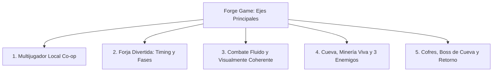

# 📜 Registro Maestro de Progresión y Desarrollo (Forge Game)

Este documento es la **fuente de verdad persistente** sobre el avance, decisiones de diseño, estado actual del código, hitos completados y la hoja de ruta técnica del proyecto **Forge Game**. Se ubica al mismo nivel que [`DEVELOPMENT_CONSTRAINTS.md`](file:///c:/Users/mauro/forge-game/DEVELOPMENT_CONSTRAINTS.md) y debe actualizarse al inicio y al final de cada sesión de desarrollo.

---

## 🧭 1. Resumen Ejecutivo y Diagnóstico del Estado Actual

### 1.1 Estado de los Módulos Existentes
| Módulo | Estado Actual | Diagnóstico y Limitaciones |
| :--- | :--- | :--- |
| **Horno (`Furnace`)** | 🟢 **Avanzado / Funcional** | Simulación térmica, adición de carbón, compuertas de ventilación, zona dorada (+60% eficiencia), inserción de minerales y generación de lupas metálicas funcionando. |
| **Prensa (`Press`)** | 🟢 **Funcional** | Conversión de lupas en lingotes planos y rectangulares con cálculo de impurezas. |
| **Yunque (`Anvil`)** | 🟡 **Técnico pero poco divertido** | Deformación analítica de vértices, corte de polilíneas/lazos cerrados (`AnvilMeshCutter`), templado diferencial y afilado implementados. **Problema**: El martillado es estático (click o sostener click sin ritmo, timing ni juego interactivo). |
| **Ensamblaje (`Assembly`)** | 🟢 **Funcional** | Integración de hoja, pomo y mango con cálculo de estadísticas (`WeaponStats`). |
| **Combate Anterior (MH/IK)** | 🔴 **Pivote Crítico Necesario** | Se intentó replicar cinemáticas complejas de *Monster Hunter* mediante cinemática inversa procedimental (`PlayerCombatIKDriver`, `ArmIK`). Al no existir animaciones 3D gratuitas en la web con la variedad requerida, el resultado es rígido y poco orgánico. Requiere pivotar a un combate estilizado, "snappy" y fluido. |
| **Multijugador Local** | 🟡 **Parcialmente preparado** | Se diseñó soporte para `playerIndex`, viewport rects en cámaras e interacciones, pero falta el `PlayerInputManager`, separación de Canvas/UI por jugador y menú de emparejamiento de mandos. |
| **Cueva y Minería** | 🔴 **Inicial / Prototipo** | Solo existe `caveHall.fbx` y el script de menas `ResourceNodeController`. No hay nivel integrado, loop de entrada/salida, enemigos reactivos ni boss. |
| **Cofres y Almacenamiento** | 🔴 **Pendiente** | No existen cofres en el campamento para guardar recursos antes de descender a la cueva. |

---

## 🔄 2. El Pivote de Diseño: De Monster Hunter a Combate Estilizado y Fluido

### ¿Por qué pivotamos?
1. **Inviabilidad de Animaciones Gratuitas**: El sistema estilo *Monster Hunter* exige cientos de transiciones milimétricas de animación mocap por cada tipo de arma (windup, active, follow-through, cancels, hitboxes hipercomplejas).
2. **El "Valle Inquietante" del IK Puro**: Animar huesos por código analítico sin poses base de animación genera movimientos robóticos y desacoplados del suelo y del torso.
3. **El Camino a la Diversión**: Es infinitamente más divertido y satisfactorio un sistema de combate **estilizado, responsivo y ágil** (estilo *Minecraft Dungeons*, *For the King*, o juegos de acción arcade en tercera persona), donde la animación sea clara, legible, con curvas de anticipación e impacto seco (*snappy*), acompañado de un excelente "game feel" (hit-stop, screen-shake y partículas).

---

## 🎯 3. Los 5 Ejes del Plan de Desarrollo



### Eje 1: Multijugador en Red Local (LAN Host-Client)
* **Objetivo**: Conexión de múltiples PCs en la misma red local (LAN) sin tope rígido de jugadores. Una PC actúa como Servidor (Host autoritativo) y las demás actúan como Clientes dependientes conectadas por IP LAN.
* **Ventajas sobre Split-Screen**:
  - Cada jugador dispone de su **pantalla completa**, su propia cámara orbital independiente y su propia UI sin solapamientos.
  - No requiere renderizar múltiples viewports simultáneos en una sola GPU.
* **Requisitos Técnicos de Red**:
  1. **Framework de Red (Netcode for GameObjects / Mirror)**:
     - Arquitectura *Server-Authoritative*: El Host simula la física del mundo, el estado térmico del horno/yunque, la salud de los enemigos y los inventarios compartidos/estaciones.
     - Los Clientes envían comandos de intención (*RPCs / ServerRpc*) y reciben variables replicadas (*NetworkVariables / SyncVars*).
  2. **Descubrimiento y Conexión LAN**:
     - Pantalla de inicio o lobby simple: "Crear Sala (Host)" / "Unirse por IP LAN" (o broadcast de descubrimiento automático en la subred).
  3. **Control de Ocupación de Estaciones en Red**:
     - Ya contemplado en [`BaseForgeStationController.cs`](file:///c:/Users/mauro/forge-game/Assets/Scripts/MainGame/Forge/Estaciones/BaseForgeStationController.cs): Si el Cliente 1 está usando el Horno, el Servidor rechaza el acceso para los demás clientes hasta que sea liberado.
  4. **Instanciación de Jugadores**:
     - Prefab de `NetworkPlayer` que activa localmente la cámara y el input solo si `IsOwner` es verdadero.

### Eje 2: Diversión en la Forja (Especial para Ferias y Exposiciones)
* **Objetivo**: Mecánicas interactivas, táctiles y con timing visual que no dependan del sonido (ideal para entornos ruidosos de ferias).
* **Mecánicas Clave**:
  1. **Horno: Límite Térmico Natural y Fuelle Rítmico de Oxígeno**:
     - El carbón solo sube la temperatura hasta su punto de combustión natural pasiva (~700°C).
     - Al alcanzar ese techo, el botón de "Añadir Carbón" cambia automáticamente a **"Soplar Aire / Fuelle"**.
     - *Mecánica diferenciada de la prensa*: No es mantener presionado ni hacer spam. Es un **ciclo de insuflación rítmica** (el fuelle se expande llenándose de aire y se bombea en el momento exacto para inyectar una ráfaga masiva de oxígeno que aviva el fuego de golpe).
  2. **Yunque: Martillado con Timing Visual por Slider / Color**:
     - Un slider o dial con código de color de alto contraste en pantalla:
       - **Centro Dorado (Sweet Spot)**: Deformación óptima (+50%), destello visual en el metal y forja perfecta.
       - **Banda Verde**: Deformación estándar.
       - **Zonas Extremas Rojas/Grises**: Golpe a destiempo, pérdida de calor y microfisuras.
     - Feedback puramente visual con números o letreros flotantes estilo arcade (*"¡PERFECTO!"*, *"¡BUENO!"*, *"¡TARDE!"*) para garantizar comprensión en eventos ruidosos.
  3. **Templado Interactivo con Penalización por Sobre-inmersión**:
     - El jugador controla la inmersión en la batea de agua.
     - **Ventana Óptima de Enfriamiento**: Se retira la hoja cuando el siseo y el gradiente térmico alcanzan la dureza ideal.
     - **Penalización por Exceso**: Si se deja dentro del agua demasiado tiempo, el choque térmico excesivo vuelve el metal quebradizo o destemplado, **bajando la calidad del metal y reduciendo las estadísticas del arma**.

### Eje 3: Combate Adaptativo con Combos de 4 a 5 Golpes según el Arma
* **Objetivo**: Combos fluidos, realistas y diferenciados según las características físicas exactas del arma creada.
* **Variables Físicas del Arma que Modifican los Combos**:
  - **Largo / Alcance**: Un martillo con mango largo ataca con mayor inercia y barridos amplios; un martillo corto golpea con mayor cadencia vertical.
  - **Peso / Distribución de Masa**: Armas con cabeza pesada tienen anticipaciones más lentas pero mayor impacto y aturdimiento.
  - **Empuñadura (1 Mano vs 2 Manos)**: Postura a una mano permite mayor movilidad lateral; postura a dos manos compromete el torso completo en golpes devastadores.
* **Estructura del Combo de 5 Golpes**:
  1. *Golpe 1 (Apertura)*: Ataque rápido de sondeo y control de distancia.
  2. *Golpe 2 (Inercia / Retorno)*: Corte o golpe aprovechando el rebote del primero.
  3. *Golpe 3 (Ruptura)*: Golpe con peso para desestabilizar guardias.
  4. *Golpe 4 (Transición / Finta)*: Giro o preparación de máxima palanca.
  5. *Golpe 5 (Finisher / Remate)*: Impacto definitivo con efecto sísmico o hendidura profunda, acompañado de *Hit-Stop* y partículas de impacto.
* **Solución de Animación por Código / Tweens y Sockets**:
  - Poses y arcos de rotación calibrados matemáticamente por arquetipo en [`ComboCatalog.cs`](file:///c:/Users/mauro/forge-game/Assets/Scripts/MainGame/Combat/ComboCatalog.cs) y sincronizados a los sockets de las manos ([`PlayerEquipmentController.Sockets.cs`](file:///c:/Users/mauro/forge-game/Assets/Scripts/MainGame/Combat/PlayerEquipmentController.Sockets.cs)).

### Eje 4: Cueva y Ecosistema de Monstruos Vivos
* **Objetivo**: Una cueva subterránea viva donde los monstruos tienen su propio ciclo biológico y no existen solo para perseguir al jugador.
* **Sistema de Spawn y Anclaje**:
  - Los puntos de spawn de los monstruos son **sus nidos con crías o vetas de minerales**.
  - Los monstruos protegen este territorio frente a intrusos.
* **Ciclo de Vida y Alimentación**:
  - Los monstruos buscan minerales para masticar o cazan a otros monstruos más pequeños de la cueva para alimentarse.
* **IA por Lista de Prioridades (Tracking y Decisiones Reactivas)**:
  1. **Prioridad 1 (Autodefensa Inmediata)**: Si el monstruo recibe daño, prioriza defenderse o huir si su salud es crítica (<25%).
  2. **Prioridad 2 (Protección Territorial)**: Si un jugador se aproxima al radio de sus crías o mena, entra en agresión territorial.
  3. **Prioridad 3 (Hambre / Alimentación)**: Si no hay peligro, busca fuentes de alimento (minerales o presas) y entra en estado de ingesta.
  4. **Prioridad 4 (Patrulla / Ocio)**: Deambula calmadamente cerca de su punto de spawn.

### Eje 5: Cofres de Campamento, Boss Final y Bucle de Retorno
1. **Cofres de Campamento (Pre-Cueva)**:
   - Almacenamiento seguro antes de descender a la cueva para evitar perder minerales refinados en caso de caer en combate.
2. **Jefe de la Cueva ("El Guardián de las Profundidades")**:
   - Monstruo alfa que protege el yacimiento más rico de la cueva.
   - Combate en 2 fases con ataques telegrafiados y caída de estalactitas. Recompensa: Mineral legendario.
3. **Bucle de Retorno**:
   - Vagoneta minera o portal que transporta a los jugadores con su botín de regreso a la forja.

---

## 📅 4. Hoja de Ruta de Implementación (Roadmap Paso a Paso)

```text
Fase 1: Multijugador LAN (Host-Client)
├── 1.1 Configurar el transporte de red LAN (Host/Server y Client connection).
├── 1.2 Implementar NetworkPlayer y sincronización de movimiento/animación de avatares.
├── 1.3 Adaptar BaseForgeStationController para replicar estados de ocupación por ClientId.
└── 1.4 Crear lobby/menú LAN simple (Hostear partida / Conectar por IP LAN).

Fase 2: Gamificación de la Forja (Especial Feria)
├── 2.1 Modificar FurnaceController.Thermal para límite térmico de carbón (~700°C) y fuelle rítmico.
├── 2.2 Diseñar AnvilTimingVisualizer (slider/dial de color de alto contraste para feria).
├── 2.3 Integrar AnvilTimingController con AnvilHammerInput y multiplicadores de deformación/calidad.
└── 2.4 Hacer interactivo el templado en AnvilQuenchDifferential con degradación de calidad por sobre-inmersión.

Fase 3: Combate Adaptativo por Características de Armas
├── 3.1 Vincular WeaponStats (largo, masa, 1H/2H) al generador de combos de ComboCatalog.
├── 3.2 Implementar AttackController fluido con curvas de aceleración y WeaponTrail.
└── 3.3 Añadir Game Feel: Hit-Stop, Screen-Shake, Hit-Flash y Knockback físico proporcional a la masa del arma.

Fase 4: Nivel de Cueva, Menas y Ecosistema de Monstruos
├── 4.1 Ensamblar sector de cueva con caveHall.fbx y distribuir menas de minerales.
├── 4.2 Crear CaveEnemyAI con lista de prioridades (Autodefensa > Proteger crías/mena > Alimentarse > Patrullar).
└── 4.3 Configurar los 3 arquetipos ecológicos (Duende Minero, Escarabajo de Roca y Quiróptero Acechador).

Fase 5: Cofre de Almacenamiento, Boss de Cueva y Retorno
├── 5.1 Programar StorageChestController e interfaz para guardar/extraer ítems en el campamento.
├── 5.2 Diseñar y programar el Boss de la cueva en 2 fases con recompensas de mineral legendario.
└── 5.3 Implementar sistema de extracción (vagoneta de salida) hacia la forja.
```

---

## 📝 5. Historial de Sesiones y Registro de Progresión

### Sesión 1 (Limpieza de Restos Procedurales y Transición a Combate Fluido)
* **Objetivos Cumplidos**:
  * **Auditoría e Historial Persistente**:
    * Creación y formalización de [`DEVELOPMENT_PROGRESSION.md`](file:///c:/Users/mauro/forge-game/DEVELOPMENT_PROGRESSION.md).
    * Definición del pivote de red: Multijugador LAN Host-Client en la misma subred.
    * Especificación de forja para ferias: Indicador visual de timing (colores/slider) inmune al ruido ambiental, combustión realista de carbón con fuelle rítmico y templado con penalización por sobre-inmersión.
    * Especificación de IA de monstruos vivos: Spawn en crías/minerales, alimentación y lista de prioridades de comportamiento.
  * **Respaldo Íntegro del Sistema Procedural/Rayman**:
    * Respaldados 17 scripts del sistema procedural/IK/Rayman en la carpeta persistente `.backup_checkpoint_procedural_rayman/`.
  * **Limpieza Total del Código Activo**:
    * Eliminados todos los restos procedurales e IK que secuestraban los huesos del paladín (`PlayerCombatIKDriver`, `ArmIK`, `TorsoDriver`, `MoveSolver`, `SphericalCoords`, `WeaponComboAnimator`, `WeaponRig`, `WeaponMotionBaker`, `AttackKeyframe`, `CombatSandboxE1`, `AttackMoveValidator`, `CombatSandboxSceneSetup`).
    * Desacoplado [`PlayerEquipmentController.cs`](file:///c:/Users/mauro/forge-game/Assets/Scripts/MainGame/Combat/PlayerEquipmentController.cs) y [`CharacterSetupTool.cs`](file:///c:/Users/mauro/forge-game/Assets/Scripts/Editor/CharacterSetupTool.cs) para otorgar a Mecanim el 100% de autoridad sobre el modelo humanoide del paladín (`character.fbx`).
  * **Mapeo de Combos de 5 Golpes Distintivos (Kevin Iglesias)**:
    * Re-asignados los 5 slots de los controladores override (`Sword1H_Override`, `Axe1H_Override`, `Hammer2H_Override`, `Heavy2H_Override`) con 5 clips de animación distintos y progresivos (eliminando la repetición de `Attack2H01`).
  * **Overhaul de Gamefeel y Tactilidad**:
    * Ajustada la duración de golpe de ~0.80s-1.10s a un ritmo ágil y dinámico de ~0.36s (1H) y ~0.44s-0.50s (2H/heavy).
    * Ventana de enlace de combo a ~0.44f con buffer de entrada anticipado para transiciones inmediatas.
    * Zancada física hacia adelante (*Lunge Impulse*) en cada golpe vía `Rigidbody.linearVelocity` con impulso potenciado (+35%) en el 5° golpe finisher.
    * *Hit-Stop* táctil (0.055s normal, 0.10s finisher) y sacudida de cámara (*Screen Shake*) en impactos.
    * Retroceso físico (*Knockback*) en objetivos impactados.
  * **Validación de Compilación y Restricciones**:
    * Compilación exitosa de `Assembly-CSharp.dll` y `Assembly-CSharp-Editor.dll` con **0 errores**.
    * Cumplimiento estricto de [`DEVELOPMENT_CONSTRAINTS.md`](file:///c:/Users/mauro/forge-game/DEVELOPMENT_CONSTRAINTS.md): los 21 archivos de combate cumplen la regla de `<= 250` líneas.

---

### Sesión 2 (Corrección Integral de Conexión de Animaciones, Postura Armada y Fluidez de Combate)
* **Diagnóstico de las 4 Fallas Críticas Reportadas**:
  1. *Desconexión al correr (Brazos vacíos de civil)*: La capa 1 (`Arms` con máscara superior de Kevin Iglesias) tenía peso 0 en el Animator y su estado por defecto era `EmptyUpper`. Al correr, `LocomotionBlend` tomaba el 100% del control y los brazos se balanceaban vacíos sin empuñar el arma.
  2. *Cancelación prematura de ataques al hacer clics*: `AttackController.cs` forzaba una duración dura de `0.36s` y un enlace de combo a `0.158s`. Un clic disparaba el buffer casi de inmediato y cancelaba el golpe antes de que la espada realizara su recorrido y conectara el golpe.
  3. *Tirones y saltos de posición entre ataques*: `PlayerMovement.FixedUpdate()` sobreescribía la velocidad del Rigidbody a 0 o velocidad de caminata cada fotograma de físicas, chocando violentamente con el impulso de avance (*Lunge*) del ataque. Además, `CrossFadeInFixedTime` forzaba tiempo normalizado `0f` reiniciando la pose abruptamente.
  4. *Animaciones sin sentido con las armas*: Una espada de 1 mano tenía mapeados tajos izquierdos (`Attack1H01_L`), estocadas de lanza a dos manos (`AttackPolearm01`) y martillazos de mandoble (`Attack2H01`), y las dagas tenían asignadas animaciones de mandoble colosal.
* **Soluciones Implementadas**:
  * **Postura Marcial Superior al Correr y Caminar (Weapon Guard)**:
    * En [`PlayerAnimator.controller`](file:///c:/Users/mauro/forge-game/Assets/Animations/Character/PlayerAnimator.controller), se configuró `CombatStance` como el estado por defecto de la capa `Arms` (Upper Body) y se estableció su peso por defecto a 1.
    * En [`PlayerEquipmentController.cs`](file:///c:/Users/mauro/forge-game/Assets/Scripts/MainGame/Combat/PlayerEquipmentController.cs), se activan las capas de torso superior (Capa 1) y agarre de mano (Capa 2) con peso `1.0f` al equipar un arma, y se desactivan a `0f` al desequipar.
    * Al atacar, la transición interna conmuta a `EmptyUpper` para otorgar autoridad completa al ataque de cuerpo entero, y al terminar el ataque regresa con un crossfade suave (0.15s) a la postura de combate.
  * **Remapeo Coherente y Realista de Animaciones por Arquetipo**:
    * **Espada 1H** ([`Sword1H_Override`](file:///c:/Users/mauro/forge-game/Assets/Animations/Character/Sword1H_Override.overrideController)): Tajo horizontal rápido (`Sword_Regular_A`), tajo diagonal reverso continuo (`Sword_Regular_B`), tajo amplio de media distancia (`Attack1H01_R`), estocada con zancada (`Sword_Dash`) y corte descendente de ejecución (`Sword_Regular_C`).
    * **Daga 1H** ([`Dagger_Override`](file:///c:/Users/mauro/forge-game/Assets/Animations/Character/Dagger_Override.overrideController)): Ataques rápidos y ágiles de filo corto sin balanceos pesados a dos manos.
    * **Hacha 1H y Maza 1H** ([`Axe1H_Override`](file:///c:/Users/mauro/forge-game/Assets/Animations/Character/Axe1H_Override.overrideController), [`Hammer1H_Override`](file:///c:/Users/mauro/forge-game/Assets/Animations/Character/Hammer1H_Override.overrideController)): Hachazo vertical contundente (`TreeChopping_Loop`), cortes horizontales y remate con aplastamiento vertical de potencia.
    * **Armas 2H Pesadas** ([`Heavy2H_Override`](file:///c:/Users/mauro/forge-game/Assets/Animations/Character/Heavy2H_Override.overrideController), [`Hammer2H_Override`](file:///c:/Users/mauro/forge-game/Assets/Animations/Character/Hammer2H_Override.overrideController)): Giros amplios de mandoble y maza colosal exclusivamente (`Attack2H01`, `NoIK@GreatswordAttack`), eliminando estocadas de lanza y golpes de escudo.
    * **Asta / Lanza** ([`Polearm_Override`](file:///c:/Users/mauro/forge-game/Assets/Animations/Character/Polearm_Override.overrideController)): Secuencias exclusivas de lanza y asta (`AttackPolearm01`, `NoIK@SpearAttack`).
  * **Timing Orgánico de Ataques y Enlace de Combos**:
    * En [`AttackController.cs`](file:///c:/Users/mauro/forge-game/Assets/Scripts/MainGame/Combat/AttackController.cs), `attackDuration` se calcula orgánicamente desde la duración base real del movimiento (`_activeMove.baseDuration`) modulada por la velocidad del arma forjada (`attackSpeed`).
    * El encadenamiento del combo (`comboTransitionTime`) se activa **únicamente después** de que el filo del arma ha barrido la ventana activa de daño (`Mathf.Max(0.62f, _activeMove.hitWindowEnd + 0.05f)`). El jugador puede hacer clic con antelación en el buffer, pero el ataque **completa su arco completo de tajo** antes de conectar fluidamente con el siguiente.
    * Se eliminó el parámetro forzado de tiempo `0f` en `CrossFadeInFixedTime($"Attack{comboIndex + 1}", 0.09f, 0)`, permitiendo que Mecanim mezcle suavemente la pose entre el final del tajo actual y el inicio del siguiente.
  * **Física y Deslizamiento Suave (Eliminación de Tirones)**:
    * Se desacopló la física en [`PlayerMovement.Physics.cs`](file:///c:/Users/mauro/forge-game/Assets/Scripts/MainGame/Movement/PlayerMovement.Physics.cs) (59 líneas) y [`PlayerMovement.cs`](file:///c:/Users/mauro/forge-game/Assets/Scripts/MainGame/Movement/PlayerMovement.cs) (213 líneas).
    * Durante el ataque (`IsAttacking`), `FixedUpdate` aplica amortiguación exponencial suave sobre la velocidad horizontal (`Vector3.Lerp(currentHVel, Vector3.zero, 6.5f * Time.fixedDeltaTime)`), permitiendo que el impulso de zancada (*Lunge*) se deslice naturalmente con peso marcial estilo Monster Hunter sin cortes abruptos a cero.
  * **Validación de Compilación y Restricciones**:
    * Ambas soluciones (`Assembly-CSharp.csproj` y `Assembly-CSharp-Editor.csproj`) compilaron con **0 errores**.
    * Todos los archivos modificados cumplen estrictamente la restricción de `<= 250` líneas (`AttackController.cs`: 249, `PlayerEquipmentController.cs`: 193, `WeaponStats.cs`: 249, `PlayerMovement.cs`: 213, `PlayerMovement.Physics.cs`: 59).

---

### Sesión 3 (Ataques Plantados al Suelo, Porte Natural Cómodo y Eliminación de Sobregesticulación)
* **Diagnóstico de las Observaciones del Usuario**:
  1. *Despegue del suelo y sobregesticulación*: `Sword_Dash` (salto hacia adelante) y `Sword_Regular_C` (salto de ejecución vertical) levantaban al personaje por los aires. Además, un multiplicador de lunge de `4.8f` proyectaba al personaje a más de 2 m/s en cada tajo rápido, haciendo que los movimientos se sintieran caóticos y desproporcionados para la velocidad del ataque.
  2. *Postura forzada e incómoda al caminar*: Al fijar la capa superior de `Arms` con `CombatIdle1H01` en peso `1.0f`, el torso y los brazos quedaban congelados en pose de duelo tenso mientras las piernas caminaban, dando un aspecto rígido, ortopédico y forzado.
* **Soluciones Implementadas**:
  * **Porte Cómodo y Natural de Armas durante la Locomoción**:
    * Se configuró la capa de torso `Arms` para permanecer en peso `0f` y estado `EmptyUpper` durante la locomoción normal en [`PlayerAnimator.controller`](file:///c:/Users/mauro/forge-game/Assets/Animations/Character/PlayerAnimator.controller) y [`PlayerEquipmentController.cs`](file:///c:/Users/mauro/forge-game/Assets/Scripts/MainGame/Combat/PlayerEquipmentController.cs).
    * La capa de manos (`Hands`, Capa 2) permanece activa con peso `1.0f` ejecutando `Human@HandsClosed01` (puños cerrados envolviendo firmemente el mango del arma).
    * **Resultado estético**: El pecho, la columna y los brazos se balancean con total cadencia orgánica y fluidez atlética al caminar y correr, con el arma sostenida de forma relajada y cómoda junto a la pierna (estilo RPG / *The Witcher* / *Monster Hunter*), eliminando toda rigidez artificial.
  * **Combos 100% Plantados al Suelo (Cero Despegue)**:
    * Se eliminaron todos los clips con saltos o desplazamientos aéreos (`Sword_Dash`, `Sword_Regular_C`, `TreeChopping_Loop`).
    * Secuencia de 5 tajos firmemente enraizados al suelo para Espada, Daga, Hacha y Maza:
      1. `Sword_Regular_A` (0.43s): Tajo horizontal rasante rápido de derecha a izquierda con pies plantados.
      2. `Sword_Regular_B` (0.53s): Tajo diagonal de retorno continuo de izquierda a derecha con pies plantados.
      3. `Attack1H01_R` (0.83s): Corte amplio marcial y pesado sin despegue de talones.
      4. `Sword_Regular_A_Rec` (0.97s): Tajo profundo y comprometido con apoyo total en el suelo.
      5. `Sword_Regular_B_Rec` (1.03s): Remate de barrido amplio con inercia controlada a nivel del piso.
  * **Contención de Impulso Físico y Anclaje Vertical**:
    * En [`AttackController.cs`](file:///c:/Users/mauro/forge-game/Assets/Scripts/MainGame/Combat/AttackController.cs), se redujo el impulso de zancada de `4.8f` a un paso marcial sobrio de `1.0f` (`~0.35m`), evitando desplazamientos desmedidos durante tajos rápidos.
    * En [`PlayerMovement.Physics.cs`](file:///c:/Users/mauro/forge-game/Assets/Scripts/MainGame/Movement/PlayerMovement.Physics.cs), se añadió restricción vertical estricta durante el ataque (`Mathf.Min(0f, _rb.linearVelocity.y)`) y desaceleración rápida (`8.5f * Time.fixedDeltaTime`), impidiendo cualquier elevación física o rebote sobre el suelo.
  * **Validación de Compilación y Restricciones**:
    * Compilación con **0 errores** en `Assembly-CSharp.csproj` y `Assembly-CSharp-Editor.csproj`.
    * Cumplimiento riguroso de [`DEVELOPMENT_CONSTRAINTS.md`](file:///c:/Users/mauro/forge-game/DEVELOPMENT_CONSTRAINTS.md): todos los archivos `<= 250` líneas.

---

### Sesión 4 (Checkpoint General y Preparación Integral de Multijugador LAN)
* **Checkpoint en Git**:
  * Formalizado commit de respaldo con el estado íntegro de forja, modelo Paladín grounded y combate previo a la integración de red.
* **Integración del Stack de Red LAN (Unity 6)**:
  * Agregado `com.unity.netcode.gameobjects` (v2.13.0), `com.unity.transport` (v2.7.4) y `com.unity.multiplayer.playmode` (v2.0.2) en [`Packages/manifest.json`](file:///c:/Users/mauro/forge-game/Packages/manifest.json).
* **Componentes de Red Desarrollados**:
  1. [`LANNetworkManagerUI.cs`](file:///c:/Users/mauro/forge-game/Assets/Scripts/MainGame/Multiplayer/LANNetworkManagerUI.cs):
     - Detección automática de IP local IPv4 del Host para conexión rápida.
     - Interfaz visual inmediata para Hostear partida (Server + P1) o unirse por IP como Cliente (P2).
     - HUD de partida activa con contador de clientes conectados y botón de desconexión.
  2. [`PlayerNetworkBridge.cs`](file:///c:/Users/mauro/forge-game/Assets/Scripts/MainGame/Multiplayer/PlayerNetworkBridge.cs):
     - Conmutación de autoridad local vs remota: activa cámara orbital e input solo en `IsOwner`.
     - Desactiva inputs y listeners en proxies remotos para evitar interferencia entre jugadores.
     - Sincronización de ataques vía `ServerRpc` y `ClientRpc` con eventos desacoplados en Mecanim.
  3. [`NetworkForgeStationBridge.cs`](file:///c:/Users/mauro/forge-game/Assets/Scripts/MainGame/Multiplayer/NetworkForgeStationBridge.cs):
     - Bloqueo autoritativo de estaciones de forja en el Servidor (`_currentOccupantClientId`).
     - Rechazo automático si un segundo jugador intenta abrir una estación que está siendo utilizada.
  4. [`MultiplayerSetupTool.cs`](file:///c:/Users/mauro/forge-game/Assets/Scripts/Editor/MultiplayerSetupTool.cs):
     - Automatización a un clic (`Tools > Forja > Configurar Escena Multijugador LAN`) que configura `NetworkManager`, `UnityTransport`, el HUD y los puentes en la escena activa.
  5. [`AttackController.cs`](file:///c:/Users/mauro/forge-game/Assets/Scripts/MainGame/Combat/AttackController.cs):
     - Exposición de evento desacoplado `OnAttackTriggered` cumpliendo estrictamente `<= 250` líneas.


---

### Sesión 5 (Estabilización Integral del Multijugador LAN, Spawning en Suelo, Movimiento WASD, Enemigo y Control de Cursor)
* **Diagnóstico de los Problemas Reportados**:
  1. *Jugador 1 (Host) aparecía bajo el piso y no podía moverse*: Al iniciar el Host en MainMenu, NGO autospawneaba el prefab NetworkPlayer con física activa (useGravity = true, isKinematic = false) en una escena sin piso 3D, cayendo al vacío antes de que la escena Furnace cargara. Además, 	ransform.position se modificaba sin NetworkTransform.Teleport(), causando interpolación rota desde el vacío.
  2. *Jugador 2 (Cliente) no podía moverse en absoluto*:
     - NetworkTransform.AuthorityMode estaba en  (Server Authority), por lo que el servidor sobreescribía la posición del cliente en cada fotograma.
     - PlayerMovement.Update() sólo leía _moveInputFromEvents si _playerInput != null, ignorando el teclado si los eventos no se disparaban.
     - PlayerCameraFollow condicionaba el control de mouse a playerIndex == 0, bloqueando la cámara para el Cliente (playerIndex == 1).
  3. *Jugador 2 no veía al enemigo cáscara/cápsula*: CombatDummyEnemy.cs tenía una comprobación if (net != null && !net.IsServer) return;, evitando que el Cliente instanciara el enemigo en Furnace.
  4. *Cursor bloqueado e invisible al salir o desconectar*: No se liberaba el cursor (Cursor.lockState = CursorLockMode.None; Cursor.visible = true;) al desconectarse, destruir el jugador, salir de la cámara orbital o regresar a MainMenu.
* **Soluciones Implementadas**:
  * **Autoridad y Teletransporte de Jugadores en Red**:
    - NetworkPlayer.prefab configurado con AuthorityMode: 1 (Owner Authority) para que cada cliente mande su propia posición.
    - [PlayerNetworkBridge.cs](Assets/Scripts/MainGame/Multiplayer/PlayerNetworkBridge.cs): en MainMenu congela la física (isKinematic = true, useGravity = false). Al cargar Furnace, posiciona al jugador en (OwnerClientId * 3.0f, 1.2f, 0f) y llama a NetworkTransform.Teleport(...) con físicas estables.
  * **Movimiento y Cámara Independiente y Robusta**:
    - [PlayerMovement.cs](Assets/Scripts/MainGame/Movement/PlayerMovement.cs): lectura directa garantizada de Keyboard.current para WASD, sprint y salto. Failsafe automático que rescata al jugador al suelo si y < -3.5f.
    - [PlayerMovement.Physics.cs](Assets/Scripts/MainGame/Movement/PlayerMovement.Physics.cs): proyección segura de cámara para evitar vectores directores nulos.
    - [PlayerCameraFollow.cs](Assets/Scripts/MainGame/Movement/PlayerCameraFollow.cs): isPrimaryCam ahora incluye a PlayerMovement.LocalInstance, garantizando órbita con ratón y control visual pleno tanto para Host como para Cliente en sus respectivas pantallas.
  * **Visibilidad del Enemigo Cápsula en Ambos Lados**:
    - [CombatDummyEnemy.cs](Assets/Scripts/MainGame/Combat/CombatDummyEnemy.cs): eliminado el bloqueo de cliente; tanto Host como Cliente instancian el enemigo de prueba en Furnace en (18.0f, 0.05f, 18.0f) para combate simultáneo.
  * **Gestión Universal del Cursor**:
    - Cursor desbloqueado y visible en PlayMainGame.cs (Start, OnEnable, OnNetworkDisconnect, CancelConnection), PlayMainGame.UI.cs (OnGUI), LANNetworkManagerUI.cs (HandleClientDisconnected, botón Desconectar), PauseMenuPanel.cs (GoToMainMenu), PlayerCameraFollow.cs (OnDisable, OnDestroy) y PlayerNetworkBridge.cs (OnNetworkDespawn, OnDestroy).
  * **Validación de Compilación y Restricciones**:
    - Assembly-CSharp.csproj y Assembly-CSharp-Editor.csproj compilaron exitosamente con **0 errores**.
    - Todos los archivos .cs del proyecto cumplen estrictamente la restricción de <= 250 líneas.

### Sesión 6 (Aislamiento de Animaciones y Camera Shake, Visualización y Ataque de Armas en Standalone, Interacción [F] en Mesas y Sincronización Visual del Yunque en Red)
* **Diagnóstico de los Problemas Reportados**:
  1. *Animaciones contaminadas entre jugadores*: Al moverse un jugador, todos los personajes conectados ejecutaban su misma animación en pantalla porque `PlayerMovement.Update()` leía el teclado local en los proxies remotos una vez habilitado el movimiento.
  2. *Camera Shake afectaba a todos los jugadores*: En `PlayerHealthController.cs`, la llamada a `CinemachineImpulseSource.GenerateImpulse()` se ejecutaba para cualquier entidad con vida dañada sin discriminar si pertenecía al cliente local o a un proxy remoto.
  3. *Jugador 2 equipaba armas pero no se veían en su mano ni podía atacar*:
     - `PlayerEquipmentController.Calibration.cs` y `Sockets.cs` cargaban los prefabs y Animation Override Controllers exclusivamente con `AssetDatabase.LoadAssetAtPath` dentro de `#if UNITY_EDITOR`. Al compilar a build standalone ejecutable, `AssetDatabase` no existe, dejando las armas y animadores en `null`.
     - `AttackController.Attack()` exigía `Cursor.lockState == CursorLockMode.Locked`, lo cual bloqueaba los ataques en el Cliente antes de que la cámara orbital capturara el mouse.
     - No existía sincronización RPC de eventos de equipamiento entre el Host y los Clientes.
  4. *Jugador 2 no podía interactuar con mesas y mostraba prompt `[L / X]`*:
     - `InteractionController.cs` mostraba `[L / X]` y solo llamaba a `Interact()` si `_playerInput` procesaba la acción.
  5. *Jugador 2 no veía el lingote ni el proceso de armado del Jugador 1 en el yunque*:
     - `AnvilController.PlaceIngot()` y `AnvilAssemblyController.BeginAssembly()` modificaban únicamente el objeto local `DeformableIngot` e instanciaban `AssemblingBladeHead` en el cliente activo. En el cliente remoto, el lingote permanecía inactivo y el modelo de la hoja no se instanciaba ni sincronizaba.
* **Soluciones Implementadas**:
  * **Aislamiento de Animaciones y Camera Shake**:
    - [PlayerMovement.cs](Assets/Scripts/MainGame/Movement/PlayerMovement.cs): Los proxies remotos (`!netObj.IsOwner`) calculan su velocidad a partir del delta de posición de red `(transform.position - _prevRemotePos) / Time.deltaTime` para alimentar `animator.SetFloat("Speed", ...)`. Ignoran el teclado local.
    - [PlayerMovement.Physics.cs](Assets/Scripts/MainGame/Movement/PlayerMovement.Physics.cs): `FixedUpdate` retorna tempranamente para proxies remotos evitando sobreescribir la posición sincronizada por `NetworkTransform`.
    - [PlayerHealthController.cs](Assets/Scripts/MainGame/Combat/PlayerHealthController.cs): El impulso de cámara Cinemachine solo se dispara si `LocalInstance == this || (netObj?.IsOwner ?? true)`.
  * **Soporte de Armas en Builds Standalone y Red**:
    - Prefabs de armas migrados a `Assets/Resources/Weapons/` y animadores a `Assets/Resources/Animations/`.
    - [PlayerEquipmentController.Calibration.cs](Assets/Scripts/MainGame/Combat/PlayerEquipmentController.Calibration.cs) y [PlayerEquipmentController.Sockets.cs](Assets/Scripts/MainGame/Combat/PlayerEquipmentController.Sockets.cs): Usan `Resources.Load` en runtime como fallback robusto para standalone builds.
    - [PlayerNetworkBridge.Sync.cs](Assets/Scripts/MainGame/Multiplayer/PlayerNetworkBridge.Sync.cs): Nuevos ServerRpc y ClientRpc (`BroadcastEquipServerRpc`/`ClientRpc`, `BroadcastUnequipServerRpc`/`ClientRpc`) para replicar armas equipadas a través de la red.
    - [AttackController.cs](Assets/Scripts/MainGame/Combat/AttackController.cs): Detección directa de click izquierdo vía `Mouse.current.leftButton.wasPressedThisFrame` para el dueño local y eliminación del bloqueo por estado del cursor.
  * **Interacción Universal `[F / X]` y Bloqueo de Estaciones en Red**:
    - [InteractionController.cs](Assets/Scripts/MainGame/Interaction/InteractionController.cs): Prompt universal `[F / X]` y sondeo directo de `Keyboard.current.fKey.wasPressedThisFrame` para el jugador local.
    - [BaseForgeStationController.cs](Assets/Scripts/MainGame/Forge/Estaciones/BaseForgeStationController.cs) y [AnvilStationController.cs](Assets/Scripts/MainGame/Forge/Yunque/AnvilStationController.cs): `CanInteract()` y `Interact()` comprueban `NetworkForgeStationBridge.IsOccupiedInNetwork` para impedir colisiones o desincronizaciones entre jugadores simultáneos.
  * **Sincronización del Lingote y Armado en el Yunque**:
    - [NetworkForgeStationBridge.cs](Assets/Scripts/MainGame/Multiplayer/NetworkForgeStationBridge.cs) y [NetworkForgeStationBridge.AnvilVisual.cs](Assets/Scripts/MainGame/Multiplayer/NetworkForgeStationBridge.AnvilVisual.cs): Variables de red sincronizadas (`_isIngotVisible`, `_isAssemblyActive`, `_anvilMetalColor`, `_anvilBaseSize`, `_anvilWeaponType`, `_bladeLocalPos`, `_bladeLocalRot`, `_handleLocalPos`) y renderizado proxy para clientes remotos.
    - [AnvilController.NetworkSync.cs](Assets/Scripts/MainGame/Forge/Yunque/AnvilController.NetworkSync.cs): Notificación automática al puente de red al colocar lingote o limpiar la mesa.
    - [AnvilAssemblyController.cs](Assets/Scripts/MainGame/Forge/Yunque/AnvilAssemblyController.cs): Notificación de inicio de armado, actualización periódica de transformaciones de la hoja durante deslizamiento e inspección, y limpieza al finalizar.
  * **Validación de Compilación y Restricciones**:
    - `Assembly-CSharp.csproj` y `Assembly-CSharp-Editor.csproj` compilaron exitosamente con **0 errores**.
    - Todos los archivos `.cs` del proyecto cumplen estrictamente con `<= 250` líneas (verificado con `check_lines.ps1`).

---

### Sesión 6 (Sistema Integral de Minas, Spawning de Minerales y Botín de Enemigos)
* **Objetivos Cumplidos**:
  1. *Spawning y Distribución de Minerales en el Mundo*:
     - Se implementó [MineSpawnerController.cs](Assets/Scripts/MainGame/Resources/MineSpawnerController.cs) con inicialización automática tras la carga de escenas de gameplay (`Furnace`, `MainGame`).
     - Distribución de yacimientos organizados:
       - **Cantera de Cobre (Copper)**: Clúster de 3 vetas ricas.
       - **Mina de Hierro (Iron)**: Clúster de 4 vetas de dureza media/alta.
       - **Foso de Carbón (Coal)**: Clúster de 4 vetas de combustible para el horno.
       - **Filón de Oro (Gold)**: Clúster de 2 vetas nobles de alta durabilidad y daño.
       - **Arboleda de Madera (Wood)**: Clúster de 4 nodos madereros para mangos y leña.
       - **Vetas de Prueba Inmediata**: 1 Veta de Cobre, 1 de Hierro y 1 de Carbón a pocos pasos de la Forja para testeo ágil con el pico recién forjado.
  2. *Visuales Procedurales 3D y Shaders URP*:
     - Creado [ResourceVisualBuilder.cs](Assets/Scripts/MainGame/Resources/ResourceVisualBuilder.cs) para generar rocas de cantera, incrustaciones cristalinas metálicas y materiales URP Lit con valores calibrados de metálico, suavidad y emisión suave para cada mineral.
  3. *Vetas Minables y Regeneración de Recursos*:
     - Actualizado [ResourceNodeController.cs](Assets/Scripts/MainGame/Resources/ResourceNodeController.cs) con respuesta de impacto físico (*shake* reactivo), extracción exclusiva con pico para minerales, dispersión radial de 2 a 4 ítems por veta y corrutina de autorrespawn (45s).
  4. *Drops Físicos y Atracción Magnética*:
     - Renovado [DroppedItemController.cs](Assets/Scripts/MainGame/Resources/DroppedItemController.cs) con factoría estática `Spawn()`, impulso balístico inicial (*pop*), oscilación flotante continua y magnetismo cinético hacia el jugador local dentro de 2.8m.
  5. *Sistema de Botín (Loot Tables) para Enemigos*:
     - Creado [EnemyLootDropper.cs](Assets/Scripts/MainGame/Combat/EnemyLootDropper.cs) con tabla de botín configurable (`LootDropEntry`) con probabilidades y cantidades (`Iron`: 75%, `Coal`: 65%, `Copper`: 50%, `Gold`: 15%, `MonsterBones`: 80%).
     - Integrado en [CombatDummyEnemy.cs](Assets/Scripts/MainGame/Combat/CombatDummyEnemy.cs) para soltar botín automáticamente en el mundo al ser derrotado.
  6. *Catálogo de Materiales*:
     - Añadidos `Wood` y `MonsterBones` a `RawMaterialCatalog` en [ForgeDataModels.cs](Assets/Scripts/MainGame/Forge/Minerales/ForgeDataModels.cs).
* **Validación de Compilación y Restricciones**:
  - `dotnet build Assembly-CSharp.csproj` completó con **0 errores**.
  - Verificación `check_lines.ps1`: **0 archivos que superen las 250 líneas** en todo el repositorio.

---

### Sesión 7 (Rotura Exclusiva con Pico de Base, Corrección de Sprint y Pausa, Arquitectura Modular de Mapa y Spawners)
* **Objetivos Cumplidos**:
  1. *Rotura Exclusiva con Pico y Equipamiento de Base*:
     - En [AttackController.cs](Assets/Scripts/MainGame/Combat/AttackController.cs), `HasPickaxeEquipped` se restringió estrictamente a `_equippedWeapon.weaponType == WeaponType.Pickaxe` (eliminando martillos y hachas).
     - En [PlayerEquipmentController.cs](Assets/Scripts/MainGame/Combat/PlayerEquipmentController.cs), en `Start()`, si el jugador no tiene arma equipada, se equipa automáticamente el pico de hierro forjado de base en mano (`PickaxeModelGenerator.CreateDefaultIronPickaxe()`).
     - Al golpear cualquier veta con espadas, dagas, hachas o martillos, el yacimiento rechaza el impacto y avisa al jugador.
  2. *Corrección de Sprint Continuo con Shift*:
     - En [PlayerMovement.cs](Assets/Scripts/MainGame/Movement/PlayerMovement.cs), se sustituyó la asignación unidireccional por sondeo continuo de `kb.leftShiftKey.isPressed || kb.rightShiftKey.isPressed` y botones de gamepad. Mantener corre; soltar pasa inmediatamente a caminar.
  3. *Corrección del Cursor en Pausa y Reanudación*:
     - En [PauseMenuPanel.cs](Assets/Scripts/MainGame/UI/PauseMenuPanel.cs), [PlayerMenuInput.cs](Assets/Scripts/MainGame/Input/PlayerMenuInput.cs) y [PlayerCameraFollow.cs](Assets/Scripts/MainGame/Movement/PlayerCameraFollow.cs), se garantiza que al salir de pausa se restaura `GameState.Exploration`, se re-bloquea el cursor (`CursorLockMode.Locked; Cursor.visible = false;`) y se recaptura al hacer clic.
  4. *Arquitectura de Spawners y Estructura del Mapa Exterior*:
     - Creado [OreVeinSpawner.cs](Assets/Scripts/MainGame/Resources/OreVeinSpawner.cs) para colocar yacimientos directamente en la escena con Gizmos de colores representativos por mineral en el Editor.
     - Creado [EnemySpawner.cs](Assets/Scripts/MainGame/Combat/EnemySpawner.cs) con radio de spawn, perímetro de patrulla y soporte para cualquier Prefab externo.
     - Creado [GenericEnemyAI.cs](Assets/Scripts/MainGame/Combat/GenericEnemyAI.cs) que permite usar cualquier modelo 3D con Animator (Speed, Attack, Die), aggro, patrulla y tabla de botín.
     - Creado [CampMapSetupTool.cs](Assets/Scripts/Editor/CampMapSetupTool.cs) con menú en `Tools > Forja > 🗺️ Construir Estructura del Mapa Exterior (Campamento)` para generar la jerarquía completa en la escena activa con un solo clic.
* **Validación de Compilación y Restricciones**:
  - `dotnet build Assembly-CSharp.csproj` y `dotnet build Assembly-CSharp-Editor.csproj` compilaron exitosamente con **0 errores**.
  - 100% de archivos `<= 250` líneas.

---

### Sesión 8 (Acuerdos Maestros de Rediseño: Horno Realista, Yunque con Fuerza Oscilante, Cueva Skyrim/The Forest y Superficie Acogedora)
* **Objetivos y Directrices Acordadas con el Usuario**:
  1. *Horno (Tiro Térmico y Fuelle de Inercia)*:
     - Reemplazar las 40 microcasillas abstractas por una escala continua de radiación térmica del fuego (Rojo Cereza $\rightarrow$ Naranja $\rightarrow$ Blanco Incandescente).
     - Marcador de carga de aleación posicionado automáticamente según el mineral más exigente (física de disolución y punto de licuefacción).
     - Fuelle interactivo con inercia térmica: el jugador insufla aire para empujar y sostener la aguja dentro de la zona de fusión.
  2. *Yunque (Fuerza Oscilante, Herramientas 3D y Silueta Tutorial)*:
     - Slider de fuerza oscilante (*bouncing bar*) que sube y rebota hasta soltar el clic.
     - Retícula de impacto bajo el ratón con área visualizada.
     - Modelos 3D visibles en mano para **Martillo** (estirar/añadir volumen), **Cincel** (desprender sobrante) y **Lija** (pulir/afilar), con selector de cambio orgánico y evidente para el jugador.
     - **Silueta Guía**: Modo tutorial que se muestra la primera vez que se forja cada tipo de arma (espada, hacha, martillo), con opción de activarla/desactivarla en el Menú de Pausa.
     - **Templado**: Eliminación de minijuegos innecesarios. Se añade el balde de agua junto al yunque con su animación de vapor/siseo y el brasero/fuego auxiliar para el hierro caliente.
     - El lingote no se enfría frustrantemente mientras el jugador se mantenga martillando activamente.
  3. *Cueva Abierta y PvE Fluido (Estilo Skyrim / The Forest)*:
     - Cueva con boca de entrada libre y sin muros artificiales ("matar a todos para abrir la puerta"). Bucle *Delve & Retreat*: entrar, minar y salir a la superficie a la forja cuando se desee.
     - Rediseño de la cueva de túnel recto a **sistema de cavernas conectadas** (Gruta de Entrada $\rightarrow$ Galería de Menas / Sala del Golem $\rightarrow$ Santuario Profundo).
     - **Combate con movilidad**: El jugador conserva el 70%-75% de velocidad de movimiento (strafe, retroceso, avance) mientras ataca, eliminando el congelamiento en el suelo.
     - **Cadencia de enemigos**: Telegrafiado claro antes de atacar y ventana de recuperación (cooldown y rodeo) para permitir esquivas y contraataques. Radio territorial de persecución (*leash*).
  4. *Diseño Antirunner y Valor del Arma en el Altar*:
     - Bloqueos físicos de terreno (derrumbes o estalagmitas que exigen herramientas reforzadas).
     - El Altar exige consagrar un **arma de alto valor de maestría** que aproveche minerales de las profundidades.
     - **Variedad horizontal y situacional de materiales**: Cobre (ligero/alta cadencia), Hierro (pesado/impacto contundente), Oro (crítico/noble pero frágil), Huesos (orgánico/efectos). Cero *power-creep* lineal aburrido; cada material tiene pros y contras reales.
  5. *Mapa de Superficie Visualmente Atractivo*:
     - Un taller de forja rústico, simple y acogedor con suelo trabajado, maderas y brasero (eliminando la sensación de estaciones flotantes en la nada).
     - Arboleda y vegetación natural que enmarquen el campamento y guíen la vista orgánicamente hacia la ladera montañosa donde se abre la cueva.