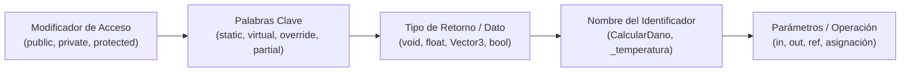
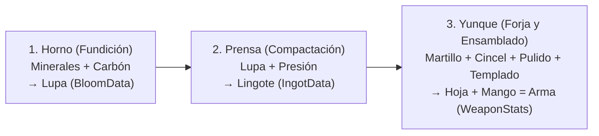
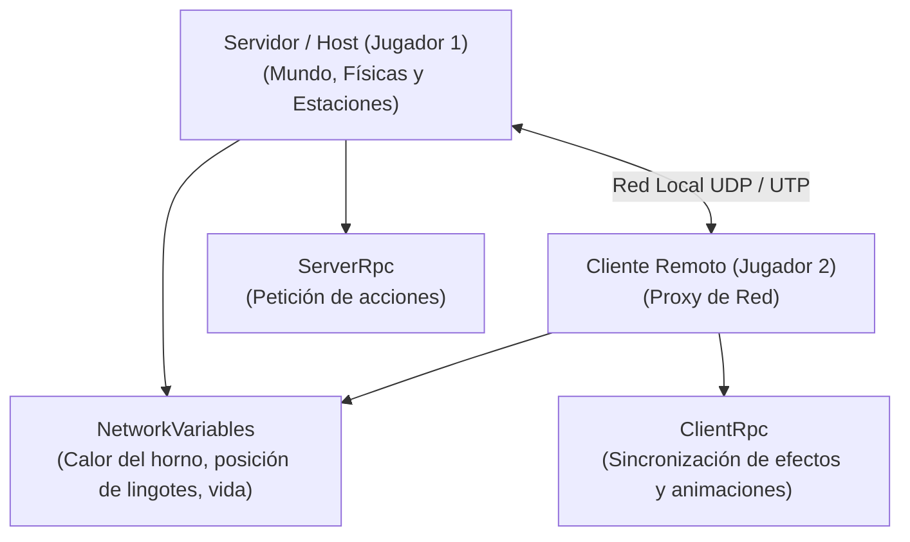
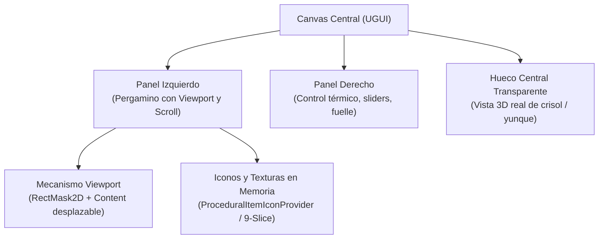
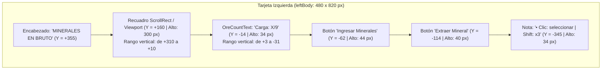

# 📖 Enciclopedia Maestra de Arquitectura, C# y Código Fuente: *Crónicas de la Fragua*

> [!IMPORTANT]
> **Propósito de esta Enciclopedia:**  
> Este documento contiene **la totalidad del conocimiento técnico del proyecto**. Integra la anatomía de líneas de código, las matemáticas 3D, el funcionamiento profundo de las estaciones, el multijugador online, la IA ecológica, los generadores de mallas/animaciones, el **sistema completo de UI, viewports, texturas y tipografías**, y el **catálogo exhaustivo de todos y cada uno de los 183 archivos `.cs`**.  
> Léelo como un manual de referencia: no necesitas memorizarlo, sino consultar la sección o archivo específico que estés programando o analizando.

---

# ÍNDICE GENERAL
1. [El Hilo Conductor del Juego: Ciclo de Vida del Mineral al Altar](#1-el-hilo-conductor-del-juego)
2. [La Anatomía de una Línea de Código en C# y Unity](#2-la-anatomía-de-una-línea-de-código-en-c-y-unity)
3. [Matemáticas y Físicas 3D en el Código](#3-matemáticas-y-físicas-3d-en-el-código)
4. [SISTEMA 1: Las Estaciones de Forja en Profundidad (Horno, Prensa, Yunque)](#4-sistema-1-las-estaciones-de-forja-en-profundidad)
5. [SISTEMA 2: El Multijugador Online LAN en Profundidad](#5-sistema-2-el-multijugador-online-lan-en-profundidad)
6. [SISTEMA 3: El Ecosistema de Monstruos y la IA Ecológica](#6-sistema-3-el-ecosistema-de-monstruos-y-la-ia-ecológica)
7. [SISTEMA 4: Creación de Modelos Procedurales y Animaciones](#7-sistema-4-creación-de-modelos-procedurales-y-animaciones)
8. [SISTEMA 5: La Interfaz de Usuario (UI), Viewports, Texturas y Tipografías](#8-sistema-5-la-interfaz-de-usuario-ui-viewports-texturas-y-tipografías)
9. [Catálogo Exhaustivo de los 183 Archivos del Proyecto por Carpeta](#9-catálogo-exhaustivo-de-los-183-archivos-del-proyecto)
10. [Índice de Búsqueda Rápida ("¿A dónde voy si quiero cambiar X?")](#10-índice-de-búsqueda-rápida)

---

# 1. El Hilo Conductor del Juego

Todo el código del proyecto se articula en torno a la **vida de un mineral y el progreso del herrero**. Desde la veta subterránea hasta la consagración divina:

```mermaid
flowchart LR
    A["⛏️ Mena en la caverna\n(ResourceNodeController)"] -->|"Pico / Drops"| B["🎒 Mineral en inventario\n(InventoryController)"]
    B -->|"Calor y Carbón"| C["🔥 Horno: Lupa\n(FurnaceController)"]
    C -->|"Prensa Hidráulica"| D["🧱 Lingote sólido\n(PressController)"]
    D -->|"Martillado, Corte y Pulido"| E["⚔️ Hoja forjada\n(AnvilController)"]
    E -->|"+ Mango tallado"| F["🗡️ Arma final\n(WeaponAssemblyController)"]
    F -->|"Clasificación de peso"| G["🥋 Arquetipo y Combo\n(WeaponAnalyzer / ComboCatalog)"]
    G -->|"Combate activo"| H["👾 Criaturas en la Cueva\n(EcologicalCaveBrain / Golem)"]
    H -->|"Ofrenda en Altar"| I["✨ Victoria Consagrada\n(GameLoopController)"]
```



---

# 2. La Anatomía de una Línea de Código en C# y Unity

Todo el código de este proyecto está construido con un conjunto de piezas fundamentales. Si entiendes cómo se combinan estas piezas, podrás leer cualquier método de cualquier archivo.



## 2.1 Modificadores de Acceso y Visibilidad
* `public`: Visible y modificable por **cualquier otro script** del proyecto y expuesto en el Inspector de Unity (si no es estático).
* `private`: Solo puede ser leído o llamado **dentro del mismo archivo/clase**. Protege datos internos para que otro script no los corrompa por error.
* `protected`: Privado para el mundo exterior, pero accesible por las clases hijas que heredan de ella (por ejemplo, `BaseForgeStationController` tiene métodos protegidos que usan `FurnaceStationController` y `AnvilStationController`).
* `internal`: Accesible por cualquier script dentro del mismo ensamblado (`Assembly-CSharp`).

## 2.2 Palabras Clave de Comportamiento Especial
* **`partial class` (Clases Parciales):**  
  ```csharp
  public abstract partial class BaseForgeStationController { ... }
  ```
  Le dice al compilador de C#: *"Esta clase continúa en otros archivos"*. Se usa para cumplir la restricción del proyecto de **≤ 250 líneas por archivo**. Por ejemplo, `AnvilController.cs`, `AnvilController.Deformation.cs` y `AnvilController.Polish.cs` son en realidad **una única clase** dividida en varios ficheros temáticos.
* **`static` (Miembros Estáticos y Singletons):**  
  ```csharp
  public static GameStateController Instance { get; private set; }
  public static readonly List<CaveCreatureBase> ActiveCreatures = new();
  ```
  La variable o método pertenece a **la clase en sí**, no a un objeto instanciado. Solo existe una copia en toda la memoria RAM. `GameStateController.Instance` permite a cualquier script consultar el estado del juego sin tener que buscarlo con `FindObjectOfType`.
* **`virtual` vs `override` (Polimorfismo):**  
  `virtual` en la clase padre indica que un método puede ser reescrito; `override` en la clase hija reemplaza o amplía esa lógica con su propia versión (usando opcionalmente `base.Metodo()` para ejecutar primero la del padre).

## 2.3 El Ciclo de Vida de Unity en el Código (Lifecycle)
| Método en el código | Cuándo se ejecuta | Para qué se usa en este proyecto |
| :--- | :--- | :--- |
| `Awake()` | Al instanciarse el objeto en memoria (incluso si está desactivado). | Inicializar variables internas, registrar Singletons (`Instance = this`). |
| `OnEnable()` / `OnDisable()` | Cuando el objeto se activa o desactiva. | Suscribirse y desuscribirse de eventos (`OnTemperatureChanged += ...`). Evita fugas de memoria. |
| `Start()` | En el primer frame de juego, antes del primer Update. | Buscar componentes que ya despertaron en `Awake`. |
| `FixedUpdate()` | A intervalos fijos de tiempo físico (50 Hz, independiente de FPS). | Físicas de `Rigidbody`, gravedad y pendientes ([`PlayerMovement.Physics.cs`](Assets/Scripts/MainGame/Movement/PlayerMovement.Physics.cs)). |
| `Update()` | En cada fotograma dibujado en pantalla (60 FPS, 144 FPS). | Leer teclas, clics del mouse, temporizadores y oscilación de barras. |
| `LateUpdate()` | En cada fotograma, pero **estrictamente después** de todos los Update. | Cámaras orbitales y cinemáticas ([`PlayerCameraFollow.cs`](Assets/Scripts/MainGame/Movement/PlayerCameraFollow.cs)). Evita tirones de imagen. |
| `OnGUI()` | Método inmediato que dibuja elementos píxel por píxel. | El HUD de salud ([`PlayerHealthController.cs`](Assets/Scripts/MainGame/Combat/PlayerHealthController.cs)) y el medidor de fuerza del martillo ([`AnvilHammerInput.GUI.cs`](Assets/Scripts/MainGame/Forge/Yunque/AnvilHammerInput.GUI.cs)). |
| `OnTriggerEnter(Collider other)` | Cuando otro collider entra en el área del trigger físico. | Recoger minerales del suelo ([`DroppedItemController.cs`](Assets/Scripts/MainGame/Resources/DroppedItemController.cs)) o cruzar puertas en la cueva. |

## 2.4 Operadores Avanzados y Sintaxis Moderna
* **Operador condicional nulo (`?.`):** `OnTemperatureChanged?.Invoke(currentTemp);`  
  *"Si alguien está escuchando el evento, dispáralo; si nadie está escuchando, no hagas nada"*.
* **Coalescencia nula (`??` y `??=`):** `handle ??= HandleData.Create(HandleLength.Medium);`  
  *"Si `handle` es null, créale un mango nuevo mediano por defecto; si ya tenía valor, consérvalo"*.
* **Asignación con tuplas y switch:**  
  ```csharp
  (float dmgMult, float speedMult, float baseRange) = weaponType switch
  {
      WeaponType.Sword  => (1.00f, 1.00f, 1.25f),
      WeaponType.Axe    => (1.35f, 0.85f, 1.10f),
      WeaponType.Hammer => (1.75f, 0.65f, 1.35f),
      _                 => (1.00f, 1.00f, 1.25f)
  };
  ```
* **Parámetros `out`:** `GetStationCameraFocus(out Vector3 focusPoint, out Vector3 camOffset);`  
  Permite que una función retorne múltiples valores simultáneos modificando variables por referencia.

---

# 3. Matemáticas y Físicas 3D en el Código

En este proyecto las armas, mallas y cámaras se calculan mediante vectores y geometría analítica.

## 3.1 Vectores Tridimensionales (`Vector3`)
* **Resta de Vectores:** `Vector3 dir = targetPos - playerPos;`  
  *Regla:* `Destino - Origen = Dirección hacia el destino`. Se usa para orientar enemigos hacia el jugador o enfocar la cámara cinemática.
* **Distancia rápida sin raíz cuadrada (`sqrMagnitude`):**  
  ```csharp
  float sqrDist = (targetPos - myPos).sqrMagnitude;
  if (sqrDist < 25f) // 5 metros al cuadrado (5 * 5 = 25)
  ```
  La raíz cuadrada de `Vector3.Distance` es costosa para la CPU. En la IA de criaturas comparamos distancias al cuadrado para optimizar el rendimiento.
* **Conversión Local a Global (`TransformDirection`):**  
  ```csharp
  Vector3 worldPos = focusPoint + transform.TransformDirection(camOffset);
  ```
  Multiplica un desplazamiento local por la rotación del mueble en el mundo para ubicar la cámara exactamente frente a la mesa sin importar su orientación.

## 3.2 Fórmulas de Interpolación y Rangos
* **`Mathf.Lerp(min, max, t)`:** Interpola suavemente entre `min` y `max` según un porcentaje `t` de 0.0 a 1.0 (cámaras, calor, barras).
* **`Mathf.InverseLerp(a, b, valor)`:** Lo opuesto a `Lerp`. Dado un valor, calcula qué porcentaje (0 a 1) representa entre `a` y `b` (riesgo por longitud del mango).
* **`Mathf.Clamp(valor, min, max)`:** Enclaustra un número para que jamás sea menor que `min` ni mayor que `max` (temperatura entre 20°C y 1500°C).
* **`Mathf.PingPong(tiempo, longitud)`:** Oscila continuamente de ida y vuelta como un péndulo entre 0 y `longitud` (aguja de fuerza del martillo en el yunque).

## 3.3 Raycasting (Los Ojos Físicos del Código)
```csharp
Ray ray = Camera.main.ScreenPointToRay(mousePos);
if (Physics.Raycast(ray, out RaycastHit hit, 100f, layerMask))
{
    Vector3 impactPoint = hit.point;
    GameObject hitObject = hit.collider.gameObject;
}
```
Traza un rayo láser invisible desde la pantalla hacia la profundidad 3D del mundo. Si choca contra un collider, entrega el punto exacto de impacto (`hit.point`) y el objeto impactado.

---

# 4. SISTEMA 1: Las Estaciones de Forja en Profundidad

La forja es una cadena de manufactura en 3 etapas secuenciales: **Horno → Prensa → Yunque**.



## 4.1 La Arquitectura Base: `BaseForgeStationController` y la Cámara Cinemática
Todas las estaciones heredan de [`BaseForgeStationController.cs`](Assets/Scripts/MainGame/Forge/Estaciones/BaseForgeStationController.cs) y [`BaseForgeStationController.Camera.cs`](Assets/Scripts/MainGame/Forge/Estaciones/BaseForgeStationController.Camera.cs):
1. **Detección e Interacción:** El jugador presiona `E` frente a la mesa. Se ejecuta `Interact(GameObject interactor)`.
2. **Bloqueo del Jugador:** Se cambia el estado a `GameStateController.SetState(GameState.Forge)`, apagando el movimiento WASD.
3. **Cinemática de Cámara en `LateUpdate()`:**
   ```csharp
   GetStationCameraFocus(out Vector3 focusPoint, out Vector3 camOffset);
   Vector3 camPos = focusPoint + transform.TransformDirection(camOffset);
   Quaternion targetRot = Quaternion.LookRotation(focusPoint - camPos);
   cam.SetStationView(camPos, targetRot, 6.0f, allowParallax: true, focusPoint: focusPoint);
   ```
4. **Salida con [Escape]:** La estación llama a `cam.RestorePlayerView()` y restaura el estado `GameState.Exploration`.

## 4.2 El Horno de Fundición (`FurnaceController`)
* **Termodinámica (`FurnaceController.Thermal.cs`):** Cada carbón resta 1 del inventario, añade segundos de combustión y eleva la temperatura objetivo (`targetTemperature`). La temperatura real sube progresivamente mediante `Mathf.MoveTowards` hasta un máximo de 1500°C. Si se agota el carbón, decae hacia los 20°C ambientales. El fuelle (`Espacio`) regula la curva de calor.
* **Química de Aleaciones (`AlloyComposition.cs`):** Promedia las propiedades ponderadas de los minerales en el crisol (3, 6 o 9 unidades). Si mezclas Cobre y Estaño, `AlloyNameRegistry.cs` bautiza el resultado como *"Bronce Clásico"*.
* **Resultado:** Condensa una esponja incandescente con impurezas llamada **Lupa** (`BloomData`).

## 4.3 La Prensa de Lingotes (`PressController`)
* **Función:** La lupa porosa recién salida del horno se coloca en la matriz de compresión.
* **Mecánica:** Al accionar la palanca, el émbolo desciende mecánicamente (`PressMechanicalVisual.cs`), expulsando escorias y chispas.
* **Resultado:** Transforma el `BloomData` en un **Lingote** sólido y denso (`IngotData`), asignando su tamaño (`Small`, `Medium`, `Large`).

## 4.4 El Yunque y la Forja Procedural (`AnvilController`)
No existen modelos 3D prefabricados de armas en el juego; el jugador esculpe el lingote con 3 herramientas:
* **Malla Subdividida Inicial (`SubdividedIngotMeshGenerator.cs`):** El lingote se genera como una grilla tridimensional densa de cientos de vértices deformables.
* **Herramienta [1] Martillo (Deformación Gaussiana):** Una aguja oscila con `Mathf.PingPong`. Al golpear en la zona verde, `AnvilController.Deformation.cs` aplica una fuerza gaussiana: los vértices cercanos al golpe se hunden y los laterales se ensanchan, conservando el volumen del metal.
* **Herramienta [2] Cincel (Corte de Mallas en Tiempo Real):** Con dos clics trazas un plano tridimensional (`Plane`). `AnvilMeshCutter.Geometry.cs` corta los triángulos que cruzan el plano, `AnvilMeshCutter.Polyline.cs` triangula una tapa interna para que el metal no quede hueco, y `AnvilOffcutSpawner.cs` hace salir volando el recorte sobrante con rebote físico en el suelo.
* **Herramienta [3] Pulidor:** Suaviza la geometría, recalcula las normales de luz (`Mesh.RecalculateNormals()`) y afina el filo cortante.
* **Templado en Agua [Espacio]:** Sumergir la hoja caliente en el barril genera una nube densa de vapor blanco (`AnvilQuenchDifferential.cs`), fijando la dureza final y el filo. Si se templa a una temperatura incorrecta, el metal se vuelve frágil.

---

# 5. SISTEMA 2: El Multijugador Online LAN en Profundidad

Permite jugar la campaña cooperativa en red local utilizando **Unity Netcode for GameObjects (NGO)** y **Unity Transport (UTP)**.



* **Configuración con un Clic (`MultiplayerSetupTool.cs`):** Crea el objeto `NetworkManager_LAN` en el puerto UDP 7777, genera el prefab `NetworkPlayer.prefab` con `NetworkObject` y `NetworkTransform`, y enlaza las estaciones.
* **Autoridad Local vs Remota (`PlayerNetworkBridge.cs`):**  
  ```csharp
  public override void OnNetworkSpawn()
  {
      if (IsOwner) SetupLocalPlayer(); // Mi personaje: activa teclado WASD y cámara orbital
      else SetupRemoteProxy();        // Mi compañero: apaga controles locales para no moverlo
  }
  ```
  Cada jugador tiene autoridad sobre su movimiento (`NetworkTransform.AuthorityModes.Owner`), enviando coordenadas a 60 Hz.
* **Sincronización de Animaciones y Ataques (`PlayerNetworkBridge.Sync.cs`):** Al hacer clic para atacar, se envía un `ServerRpc` al host, el cual responde con un `ClientRpc` a los demás jugadores para reproducir la animación del swing y el impacto en sus respectivas pantallas.
* **Sincronización de la Forja (`NetworkForgeStationBridge.AnvilVisual.cs`):** Usa `NetworkVariable<T>` para replicar el calor y color incandescente del lingote. Cuando un jugador martilla la hoja, los nuevos vértices deformados se sincronizan por la red para que ambos herreros vean la espada deformarse en tiempo real.

---

# 6. SISTEMA 3: El Ecosistema de Monstruos y la IA Ecológica

Los monstruos subterráneos no persiguen al jugador en línea recta de forma fija; forman parte de un ecosistema vivo regulado por necesidades biológicas:

* **Rendimiento Zero-GC (`CaveCreatureBase.cs`):** Todas las criaturas vivas se registran en listas estáticas activas (`ActiveCreatures`). Ningún script ejecuta `FindObjectsOfType`, manteniendo una tasa de cuadros estable sin tirones de memoria.
* **El Árbol de Decisión Ecológico (`EcologicalCaveBrain.cs`):**  
  Clase de C# puro que evalúa las prioridades del monstruo en cada frame:
  1. *`CriticalFlee` (Vida < 20%):* Instinto de supervivencia; huye despavorido.
  2. *`SelfDefense`:* Si fue golpeado por el jugador, contraataca.
  3. *`TerritorialDefense` (Veta picada a < 15 m):* Si el jugador pica un mineral con el pico, la roca emite una onda sonora. El Golem ruge, sus ojos brillan y embiste al minero. Si pasas caminando sin picar, te ignora pacíficamente.
  4. *`HuntLivingPrey` (Hambre > 70%):* Caza presas activas en la caverna.
  5. *`CalmPatrol`:* Si no hay amenazas, patrulla en calma entre las formaciones rocosas.
* **Tácticas Arácnidas (`SpiderEnemyController.cs` y `SpiderBroodNest.cs`):** Las arañas acechan en techos y cornisas y calculan saltos parabólicos balísticos (`rb.velocity = leapVelocity`). Si el jugador ataca un nido de huevos, todas las arañas adultas del sector entran en modo `DefendBrood` para proteger la cría.

---

# 7. SISTEMA 4: Creación de Modelos Procedurales y Animaciones

El juego minimiza la dependencia de archivos 3D externos pesados generando modelos, texturas y configuraciones de esqueleto de forma matemática.

* **Generación de Mallas 3D por Código (`Mesh`):**  
  Una malla se construye manipulando 4 arrays en memoria:
  * `vertices`: Coordenadas de los puntos en el espacio.
  * `triangles`: Índices de vértices agrupados de 3 en 3 (en sentido horario para orientar las caras frontales).
  * `normals`: Vectores perpendiculares que determinan cómo rebota la iluminación.
  * `uv`: Coordenadas 2D de mapeo para las texturas.  
  Scripts como `PickaxeModelGenerator.cs` (mango cilíndrico y cabeza curva de hierro) y `OreMeshGenerator.cs` (rocas facetadas deformadas con ruido Perlin) generan los assets matemáticamente en runtime.
* **Sistema de Animaciones Humanoides (UAL2):**  
  Utiliza clips del estándar Humanoid de la librería `Universal Animation Library 2`:
  * *`ForgeCombatCompleteInstaller.cs`:* Genera programáticamente el `AnimatorController` en el editor, creando la capa base de locomoción (Blend Tree 2D de Idle/Walk/Run) y la capa superior de combate (`UpperBody Combat Layer`) con un Avatar Mask en el torso. Esto permite al herrero **atacar o cargar golpes mientras sigue corriendo con las piernas sin congelarse**.
  * *Alineación Dinámica del Filo (`DynamicEdgeAligner.cs`):* Compara el vector normal del filo forjado con la dirección del swing del brazo mediante el producto punto (`Vector3.Dot`):
    * Si impactas alineado con el filo (> 0.70): **Golpe crítico cortante (+50% de daño)**.
    * Si impactas plano con el lomo (< 0.20): **Golpe contundente ineficaz (-50% de daño)**.

---

# 8. SISTEMA 5: La Interfaz de Usuario (UI), Viewports, Texturas y Tipografías

La interfaz de *Crónicas de la Fragua* es un sistema híbrido que combina **Canvas de UGUI de alta fidelidad estética** con un **marco visual 3D transparente**.



---

## 8.1 ¿Qué es Técnicamente un Viewport en Unity UI y Cómo Opera?

En la interfaz de Unity (UGUI), un **`Viewport`** no es una simple imagen: es una **ventana de recorte físico (Masking Window)** que pertenece a un componente `ScrollRect`.

### Estructura Jerárquica Obligatoria de un Scroll:
```text
ScrollRect (Contenedor Maestro con física de arrastre)
  └── Viewport (Marco de recorte con RectTransform + RectMask2D)
        └── Content (Contenedor elástico con todos los botones / celdas)
```

1. **El `ScrollRect`:** Escucha la rueda del ratón y el arrastre táctil. Desplaza el contenedor `Content` en el eje `Y` (vertical) o `X` (horizontal).
2. **El `Viewport` (La Máscara):**  
   * Posee un componente **`RectMask2D`**.
   * **¿Por qué usamos `RectMask2D` y no `Mask` tradicional?:**  
     El componente `Mask` de Unity utiliza el *Stencil Buffer* de la GPU, lo cual obliga a recalcular llamadas de dibujado (*draw calls*) adicionales y rompe el batching. `RectMask2D`, en cambio, recorta los elementos matemáticamente en 2D en el shader de fragmentos sin coste adicional de GPU.
3. **El `Content`:** Es un `RectTransform` hijo cuyo tamaño crece dinámicamente con un `VerticalLayoutGroup` y un `ContentSizeFitter`. Todo lo que queda dentro del rectángulo del Viewport se dibuja; lo que sobresale queda recortado.

### Las Matemáticas de Anclaje del Viewport ([`ForgeScrollViewStyler.cs`](Assets/Scripts/MainGame/UI/ForgeScrollViewStyler.cs)):
```csharp
scrollRect.viewport.anchorMin = Vector2.zero; // (0, 0) Esquina inferior izquierda
scrollRect.viewport.anchorMax = Vector2.one;  // (1, 1) Esquina superior derecha
scrollRect.viewport.offsetMin = Vector2.zero;
scrollRect.viewport.offsetMax = Vector2.zero;
scrollRect.viewport.pivot = new Vector2(0f, 1f); // Pivote arriba a la izquierda
```
Esto garantiza que el Viewport se estire y llene exactamente el 100% del área rectangular definida para la lista, sin desbordarse ni 1 píxel.

---

## 8.2 El Problema del Solapamiento de Textos y Cómo se Solucionó

> [!WARNING]
> **¿Por qué el texto del horno se metía dentro del Viewport?**  
> En el diseño del horno, la tarjeta izquierda (`leftBody`) contiene la lista scrolleable de minerales, el contador de carga (`OreCountText`), los botones de ingresar/extraer y las notas de ayuda (`LeftControlsHint`).  
> Si `OreCountText` se emparentaba por error dentro del Viewport o se colocaba en un rango de coordenadas `Y` que coincidía con el área del `ScrollRect`, al desplazarse la lista los minerales se dibujaban por encima del texto, o el texto quedaba recortado por la máscara.

### La Solución Matemática por Coordenadas Fijas ([`ForgeCanvasThemeStyler.Furnace.cs`](Assets/Scripts/MainGame/UI/ForgeCanvasThemeStyler.Furnace.cs)):
Organizamos los elementos en una escala vertical estricta sin solapamientos:



Al asignar `oreScroll` en `Y = +160` (su borde inferior llega a `+10`) y colocar `OreCountText` en `Y = -14`, existe un colchón de 24 píxeles limpios entre el final del Viewport y el inicio del texto. Nada entra en el Viewport.

---

## 8.3 Viewport 2D de UI vs La Previsualización 3D Real

> [!NOTE]
> **El Secreto del Hueco Central:**  
> A diferencia de otros juegos que renderizan un modelo 3D secundario en una textura virtual (`RenderTexture`) para mostrar el crisol o el lingote, en este proyecto **la previsualización es el mundo 3D real**:
> * Los paneles `leftBody` (anclado a `X = -665f`) y `rightBody` (anclado a `X = +665f`) actúan como un marco teatral de pergamino a los costados de la pantalla.
> * El centro de la pantalla (más de 850 píxeles de ancho) es **completamente transparente**.
> * La cámara principal (`Camera.main`), guiada por [`BaseForgeStationController.Camera.cs`](Assets/Scripts/MainGame/Forge/Estaciones/BaseForgeStationController.Camera.cs), hace zoom cinematográfico y encuadra el crisol físico con los trozos de roca derritiéndose y las llamas incandescentes en vivo a resolución nativa sin consumir memoria de texturas secundarias.

---

## 8.4 El Sistema de Imágenes y Texturas Procedurales (Sin Archivos Externos)

El proyecto crea todas sus texturas en memoria RAM al arrancar el juego mediante código C# puro:

### A. Pergaminos y Cuero con 9-Slicing ([`BookTextureBuilder.cs`](Assets/Scripts/MainGame/UI/BookTextureBuilder.cs))
1. **Creación en RAM:** Crea un `Texture2D` de 128x128 píxeles con formato `RGBA32`.
2. **Generación de Ruido Perlin:**
   ```csharp
   float noise = (Mathf.PerlinNoise(x * 0.15f, y * 0.15f) - 0.5f) * 0.04f;
   Color col = Color.Lerp(edgeCol, baseCol, t) + new Color(noise, noise, noise, 0f);
   tex.SetPixel(x, y, col);
   ```
   Aplica una sombra sepia en los bordes y grano de pergamino antiguo mediante ruido matemático.
3. **La Técnica de 9-Slicing (Sprite 9-Slice):**
   ```csharp
   _parchmentSprite = Sprite.Create(tex, new Rect(0, 0, w, h), new Vector2(0.5f, 0.5f), 100f, 0, 
       SpriteMeshType.FullRect, new Vector4(12, 12, 12, 12));
   ```
   * **¿Qué hace `new Vector4(12, 12, 12, 12)`?:** Divide el sprite en una cuadrícula de 3x3 (9 rebanadas: 4 esquinas, 4 bordes y 1 centro).
   * Al estirar una tarjeta a 480x820 píxeles, Unity **no deforma ni pixela las 4 esquinas ornamentadas**; únicamente estira el centro y repite los bordes rectos.
4. **Pespuntes de Cuero Cosido:** En `GetLeatherCoverSprite()`, dibuja costuras de hilo dorado alternando píxeles periódicos con el operador módulo: `(y % 6 < 4)`.

### B. Generador Procedural de Iconos 2D de Ítems ([`ProceduralItemIconProvider.cs`](Assets/Scripts/MainGame/UI/ProceduralItemIconProvider.cs))
Genera miniaturas nítidas de 64x64 píxeles para el inventario y hornos sin requerir sprites externos:
* **Armas:** Dibuja la silueta de la hoja metálica, la cruceta y el pomo según el tipo (`Sword`, `Axe`, `Hammer`).
* **Mangos:** Dibuja un cilindro de madera con anillos de agarre.
* **Lupas (`Bloom`):** Genera una masa globular porosa con el color incandescente del metal fundido.
* **Lingotes (`Ingot`):** Dibuja un lingote trapezoidal clásico con biselado de sombras y brillo metálico.
* **Minerales:** Dibuja cúmulos de roca facetada con motas de carbón negro o vetas de cobre/hierro/oro.

---

## 8.5 El Sistema de Tipografía Renacentista y Textos ([`MedievalTypographyProvider.cs`](Assets/Scripts/MainGame/UI/MedievalTypographyProvider.cs))

Para mantener la ambientación histórica, el juego rechaza fuentes modernas sans-serif (como Arial o Roboto) y utiliza fuentes serif del sistema operativo:

### A. Familias Tipográficas Utilizadas:
1. **`Georgia`:** Fuente principal para lectura; trazo elegante con remates clásicos y alta legibilidad sobre fondos de pergamino claro.
2. **`Palatino Linotype`:** Inspirada en la caligrafía italiana del siglo XVI (Giambattista Palatino).
3. **`Constantia`:** Tipografía serif de proporciones renacentistas con números de estilo antiguo.
4. **`Times New Roman` y `Cambria`:** Fallbacks seguros presentes en cualquier equipo con Windows.

### B. Creación Dinámica de Fuentes TextMeshPro (TMP SDF) en Runtime:
```csharp
_cachedTmpFont = TMP_FontAsset.CreateFontAsset(family, "Regular", 90);
```
* Genera dinámicamente un activo TextMeshPro utilizando **Signed Distance Field (SDF)**.
* **Ventaja técnica:** El texto se mantiene 100% nítido a cualquier resolución (1080p, 1440p, 4K) sin bordes borrosos ni pixelado al escalar las ventanas.

### C. Paleta de Tintas Medievales (Theme Color Palette):
* **`DarkInk` (`#2b1d0c`):** Tinta sepia oscura; utilizada en títulos principales y nombres de objetos para máximo contraste contra el pergamino.
* **`SubInk` (`#5c4a38`):** Tinta castaña media; utilizada en descripciones y notas secundarias.
* **`FireRed` (`Color(0.68f, 0.20f, 0.06f)`): Tinta carmesí de calor para temperaturas del horno y advertencias de peligro.
* **`GoldAccent` (`#d4a017`):** Tinte de latón y oro para títulos de placas ornamentadas.

---

## 8.6 Catálogo de Paneles del Juego

| Panel de UI | Script Principal | Distribución y Elementos Clave |
| :--- | :--- | :--- |
| **Horno de Fundición** | [`FurnacePanel.cs`](Assets/Scripts/MainGame/UI/FurnacePanel.cs) | 3 zonas: Tarjeta izquierda (minerales + Viewport con `RectMask2D`), Centro transparente (crisol 3D real), Tarjeta derecha (termómetro, carbón restante `+ Carbón (X)` y botón fuelle). |
| **Prensa de Lingotes** | [`PressPanel.cs`](Assets/Scripts/MainGame/UI/PressPanel.cs) | Matriz central con listado de lupas en inventario y botón grande de estampar con pistón mecánico. |
| **Yunque y Forja** | [`AnvilPanel.cs`](Assets/Scripts/MainGame/UI/AnvilPanel.cs) | Selector inicial de lingote y plano; HUD inferior en `OnGUI` con retícula central, medidor oscilante de fuerza, estado térmico y botones `[1] Martillo`, `[2] Cortar`, `[3] Pulir`. |
| **Inventario (Códice)** | [`InventoryPanel.cs`](Assets/Scripts/MainGame/UI/InventoryPanel.cs) | Libro abierto de dos páginas con encuadernación de cuero y marcapáginas de cinta. Apila ítems iguales (`Mango x3`) y muestra detalles físicos (filo, masa, dureza) con botón de equipar. |
| **Menú de Pausa** | [`PauseMenuPanel.cs`](Assets/Scripts/MainGame/UI/PauseMenuPanel.cs) | Placa de pergamino con botones tallados en madera: reanudar, deslizador de volumen de audio estrictamente calibrado en su carril, alternar **Tutorial (Siluetas)** y salir. |
| **HUD de Salud** | [`PlayerHealthController.cs`](Assets/Scripts/MainGame/Combat/PlayerHealthController.cs) | Renderizado en `OnGUI` en la esquina superior izquierda: icono de corazón `♥`, barra de vida y valores numéricos compactos sin sobrecargar el Canvas. |

---

# 9. Catálogo Exhaustivo de los 183 Archivos del Proyecto

A continuación se detalla la función exacta de **todos y cada uno de los archivos C#** organizados por carpeta.

---

### Carpeta 1: Núcleo, Menús e Input (`MainGame/Core`, `Input`, `GameLoop`, `AreaTrigger`) [9 archivos]
| Archivo | Qué hace exactamente | Métodos y Variables Clave | Modo de Aplicación en el Juego |
| :--- | :--- | :--- | :--- |
| [GameStateController.cs](Assets/Scripts/MainGame/Core/GameStateController.cs) | Máquina de estados central (`Exploration`, `Forge`, `Pause`). Contiene `TutorialSettings`. | `SetState()`, `IsForging`, `TutorialSettings.BlueprintOutlinesEnabled` | Bloquea el movimiento del jugador cuando entra a una estación o abre el menú de pausa. |
| [IUIPanel.cs](Assets/Scripts/MainGame/Core/IUIPanel.cs) | Contrato obligatorio para cualquier ventana o menú del juego. | `Open()`, `Close()`, `IsOpen`, `PanelName` | Permite que el sistema cierre automáticamente cualquier panel abierto antes de abrir otro. |
| [UIPanelBase.cs](Assets/Scripts/MainGame/Core/UIPanelBase.cs) | Base de todos los Canvas. Maneja el fundido alfa del `CanvasGroup`. | `Open()`, `Close()`, `SetVisible()`, `IsAnyPanelOpen` | Controla el fundido alfa y bloquea clics que atraviesen las ventanas UI. |
| [UnitySafeUtility.cs](Assets/Scripts/MainGame/Core/UnitySafeUtility.cs) | Destructor seguro de objetos para evitar errores entre modo edición y juego. | `SafeDestroy(Object obj)` | Destruye objetos con `DestroyImmediate` en el editor y `Destroy` en runtime. |
| [GameLoopController.cs](Assets/Scripts/MainGame/GameLoop/GameLoopController.cs) | Orquestador de la partida: muerte, respawn y victoria en el altar. | `OnPlayerDefeated()`, `RespawnPlayer()`, `TriggerVictory()` | Reinicia al jugador en el taller tras morir y limpia el inventario del botín no asegurado. |
| [PlayerMenuInput.cs](Assets/Scripts/MainGame/Input/PlayerMenuInput.cs) | Captura las teclas globales (`Escape`, `Tab`, `I`, `P`, `F3`). | `Update()`, `UpdateMovementAvailability()` | Traduce presiones de teclado en comandos desacoplados para los paneles. |
| [MenuCommandRouter.cs](Assets/Scripts/MainGame/Input/MenuCommandRouter.cs) | Enrutador que recibe comandos de teclado y abre el panel correspondiente. | `ToggleInventory()`, `TogglePause()`, `CloseAll()` | Desacopla el teclado de las referencias directas a los paneles UI. |
| [IMenuCommandHandler.cs](Assets/Scripts/MainGame/Input/IMenuCommandHandler.cs) | Contrato de comandos de interfaz. | `ExecuteCommand(MenuCommand cmd)` | Permite sustituir o interceptar el menú en modo multijugador o cinemáticas. |
| [AreaTrigger.cs](Assets/Scripts/MainGame/AreaTrigger/AreaTrigger.cs) | Disparador de volumen genérico para colisiones físicas. | `OnTriggerEnter()`, `OnTriggerExit()` | Detecta cuando el jugador cruza umbrales de la cueva o entra en zonas de talleres. |

---

### Carpeta 2: Jugador, Movimiento y Cámara (`MainGame/Movement`, `Interaction`, `Combat`) [8 archivos]
| Archivo | Qué hace exactamente | Métodos y Variables Clave | Modo de Aplicación en el Juego |
| :--- | :--- | :--- | :--- |
| [PlayerMovement.cs](Assets/Scripts/MainGame/Movement/PlayerMovement.cs) | Lee el teclado (`WASD`, `Shift`, `Espacio`), rota al jugador hacia la cámara y aplica animaciones. | `Update()`, `SetMovementEnabled()`, `IsMoving` | Mueve al personaje principal en tercera persona y coordina el Animator. |
| [PlayerMovement.Physics.cs](Assets/Scripts/MainGame/Movement/PlayerMovement.Physics.cs) | Físicas de `Rigidbody`: gravedad personalizada, chequeo de suelo y ajuste a pendientes de roca. | `FixedUpdate()`, `CheckGrounded()`, `ApplySlopePhysics()` | Evita que el jugador resbale en colinas o vuele al caminar por desniveles en la cueva. |
| [PlayerCameraFollow.cs](Assets/Scripts/MainGame/Movement/PlayerCameraFollow.cs) | Cámara orbital en tercera persona. Sigue la cabeza del herrero y rota con el mouse. | `LateUpdate()`, `HandleMouseOrbit()`, `CheckCollisions()` | Proporciona visión fluida alrededor del personaje y evita que la cámara traspase paredes. |
| [PlayerCameraFollow.Station.cs](Assets/Scripts/MainGame/Movement/PlayerCameraFollow.Station.cs) | Cinemática de transición hacia estaciones de trabajo. | `SetStationView()`, `RestorePlayerView()` | Interpola suavemente el lente desde la espalda del jugador hacia el plano de la forja. |
| [InteractionController.cs](Assets/Scripts/MainGame/Interaction/InteractionController.cs) | Lanza un cono de detección frontal para encontrar objetos interactuables al pulsar `E`. | `Update()`, `FindBestInteractable()`, `TryInteract()` | Muestra el mensaje *"Presiona [E] para usar"* al mirar yunques, hornos, menas o altares. |
| [IInteractable.cs](Assets/Scripts/MainGame/Interaction/IInteractable.cs) | Contrato para todo objeto que responde a la tecla `E`. | `CanInteract()`, `Interact(GameObject interactor)`, `GetPrompt()` | Lo implementan estaciones de forja, el altar consagrado y minerales. |
| [IForgeOpener.cs](Assets/Scripts/MainGame/Interaction/IForgeOpener.cs) | Interfaz especializada para abrir interfaces de forja desde triggers. | `OpenForge()` | Vincula triggers físicos con el panel correspondiente. |
| [PlayerHealthController.cs](Assets/Scripts/MainGame/Combat/PlayerHealthController.cs) | Gestiona la vida del herrero, daño por ataque, muerte y dibuja el HUD minimalista con corazones. | `TakeDamage()`, `Heal()`, `OnGUI()`, `CurrentHealth` | Dibuja la barra de vida y corazones en pantalla sin ocupar memoria Canvas. |

---

### Carpeta 3: Datos, Metales e Inventario (`MainGame/Forge/Minerales`, `Inventory`, `Data/ScriptableObjects`) [13 archivos]
| Archivo | Qué hace exactamente | Métodos y Variables Clave | Modo de Aplicación en el Juego |
| :--- | :--- | :--- | :--- |
| [ForgeDataModels.cs](Assets/Scripts/MainGame/Forge/Minerales/ForgeDataModels.cs) | Define las estructuras maestras: `BloomData`, `IngotData`, `HandleData` y `IForgeItem`. | `MetalType`, `WeaponType`, `ItemSize`, `HandleLength` | Núcleo de datos tipados que viajan entre el horno, la prensa y el yunque. |
| [MetalProperties.cs](Assets/Scripts/MainGame/Forge/Minerales/MetalProperties.cs) | Propiedades fisicoquímicas de cada metal: punto de fusión, dureza, densidad, filo y color incandescente. | `MeltingPoint`, `Hardness`, `BaseDamage`, `Density` | Define que el Cobre funda rápido y el Hierro resista golpes pesados. |
| [AlloyComposition.cs](Assets/Scripts/MainGame/Forge/Minerales/AlloyComposition.cs) | Calcula el promedio ponderado de mezclas metálicas (ej: Bronce = Cobre + Estaño). | `CalculateWeightedProperties()`, `GetDominantMetal()` | Determina las estadísticas físicas resultantes de una aleación en el crisol. |
| [AlloyNameRegistry.cs](Assets/Scripts/MainGame/Forge/Minerales/AlloyNameRegistry.cs) | Asigna nombres y títulos a las aleaciones según su porcentaje químico dominante. | `GetAlloyName(AlloyComposition comp)` | Bautiza al lingote como *"Bronce Ancestral"* o *"Acero de Damasco"*. |
| [WeaponStats.cs](Assets/Scripts/MainGame/Forge/Minerales/WeaponStats.cs) | Hoja de estadísticas del arma terminada: daño, velocidad, peso, durabilidad y filo. | `Damage`, `AttackSpeed`, `Durability`, `Reach` | Se transfiere al sistema de combate para determinar el daño y arquetipo del arma. |
| [IForgeItem.cs](Assets/Scripts/MainGame/Forge/Minerales/IForgeItem.cs) | Interfaz común para ítems forjables con aleación y tamaño. | `AlloyComposition Composition`, `ItemSize Size` | Permite tratar lupas y lingotes de forma polimórfica en inventario y UI. |
| [InventoryController.cs](Assets/Scripts/MainGame/Inventory/InventoryController.cs) | Almacén del herrero: gestiona recursos contables (carbón, menas) y piezas forjadas. | `AddItem()`, `RemoveItem()`, `GetCount()`, `Blooms`, `Ingots` | Consulta si tienes suficiente carbón o minerales para fundir. |
| [InventoryController.Defaults.cs](Assets/Scripts/MainGame/Inventory/InventoryController.Defaults.cs) | Configura el equipamiento y recursos iniciales al comenzar la partida. | `InitializeStartingInventory()`, `ClearAtRiskLoot()` | Entrega el carbón inicial duplicado y el pico de minería. |
| [IInventoryReceiver.cs](Assets/Scripts/MainGame/Inventory/IInventoryReceiver.cs) | Interfaz para recibir transferencias de objetos hacia el inventario. | `ReceiveItem(string id, int count)` | Permite que drops y estaciones agreguen ítems sin referencias rígidas. |
| [ItemDefinitionSO.cs](Assets/Scripts/MainGame/Data/ScriptableObjects/ItemDefinitionSO.cs) | ScriptableObject base para definir metadatos de ítems visuales e íconos. | `ItemId`, `DisplayName`, `Icon` | Soporte extensible de ítems estáticos en el proyecto. |
| [WeaponRecipeSO.cs](Assets/Scripts/MainGame/Data/ScriptableObjects/WeaponRecipeSO.cs) | ScriptableObject con recetas de armas y planos guía para el yunque. | `RecipeName`, `TargetSilhouette`, `RequiredMetal` | Catálogo de referencia para el diario de recetas. |
| [HandleDefinitionSO.cs](Assets/Scripts/MainGame/Data/ScriptableObjects/HandleDefinitionSO.cs) | ScriptableObject para definiciones de maderas y mangos tallables. | `HandleType`, `WoodHardness`, `LengthMultiplier` | Define multiplicadores de estabilidad de los tipos de madera. |
| [ForgeSpriteDatabase.cs](Assets/Scripts/MainGame/Data/ScriptableObjects/ForgeSpriteDatabase.cs) | Almacén de sprites de fallback y texturas para menús. | `GetSprite(string key)` | Provee texturas cuando no se usa generación procedural. |

---

### Carpeta 4: Estaciones Base y Ensamblaje (`MainGame/Forge/Estaciones`, `Ensamblaje`) [6 archivos]
| Archivo | Qué hace exactamente | Métodos y Variables Clave | Modo de Aplicación en el Juego |
| :--- | :--- | :--- | :--- |
| [BaseForgeStationController.cs](Assets/Scripts/MainGame/Forge/Estaciones/BaseForgeStationController.cs) | Clase base abstracta de las 3 estaciones de forja. Maneja ocupación y estado. | `Interact()`, `OnStationEntered()`, `OnStationExited()` | Bloquea al jugador y abre la UI correspondiente al interactuar con cualquier mesa. |
| [BaseForgeStationController.Camera.cs](Assets/Scripts/MainGame/Forge/Estaciones/BaseForgeStationController.Camera.cs) | Gestión cinemática de la cámara hacia la mesa de trabajo en `LateUpdate`. | `GetStationCameraFocus()`, `GetInteractorCamera()`, `StartStationCamera()` | Orienta suavemente el punto de vista 3D hacia el crisol, prensa o yunque. |
| [ForgeStationController.cs](Assets/Scripts/MainGame/Forge/Estaciones/ForgeStationController.cs) | Wrapper de interacción para estaciones unificadas. | `OnTriggerEnter()`, `OpenMenu()` | Soporte de compatibilidad con versiones legacy de la forja. |
| [ForgeController.cs](Assets/Scripts/MainGame/Forge/Estaciones/ForgeController.cs) | Controlador integrador de la secuencia de forja. | `ProcessForgeStep()` | Coordina el avance de estados entre fundición, compresión y forja. |
| [ForgeStationModelSetup.cs](Assets/Scripts/MainGame/Forge/Estaciones/ForgeStationModelSetup.cs) | Constructor procedural de los muebles 3D de las estaciones en la escena. | `BuildStationMesh()`, `SetupColliders()` | Crea la geometría 3D de los mesones y chimeneas sin requerir modelos externos FBX. |
| [WeaponAssemblyController.cs](Assets/Scripts/MainGame/Forge/Ensamblaje/WeaponAssemblyController.cs) | Calculadora de estadísticas finales: une química del lingote, cortes y mango. | `AssembleWeapon()` | Determina el daño final, agilidad y alcance del arma resultante. |

---

### Carpeta 5: Horno de Fundición (`MainGame/Forge/Horno`) [7 archivos]
| Archivo | Qué hace exactamente | Métodos y Variables Clave | Modo de Aplicación en el Juego |
| :--- | :--- | :--- | :--- |
| [FurnaceStationController.cs](Assets/Scripts/MainGame/Forge/Horno/FurnaceStationController.cs) | Estación física del horno: recibe la tecla `E`, llama a la cámara y abre `FurnacePanel`. | `Interact()`, `GetStationCameraFocus()` | Punto de entrada del jugador al horno. |
| [FurnaceController.cs](Assets/Scripts/MainGame/Forge/Horno/FurnaceController.cs) | Cerebro de fundición: conecta los subsistemas térmico, de minerales y de lupas. | `Update()`, `ResetFurnace()`, `IsSmeltingActive` | Ejecuta el loop por frame del proceso de fundido. |
| [FurnaceController.Thermal.cs](Assets/Scripts/MainGame/Forge/Horno/FurnaceController.Thermal.cs) | Termodinámica: quema de carbón, subida de calor, enfriamiento y fuelle con [Espacio]. | `AddCoal()`, `PumpBellows()`, `CurrentTemperature` | Simula la física de temperatura (hasta 1500°C) necesaria para fundir minerales. |
| [FurnaceController.Ores.cs](Assets/Scripts/MainGame/Forge/Horno/FurnaceController.Ores.cs) | Gestión de carga del crisol: acepta combinaciones de 3, 6 o 9 menas. | `InsertOre()`, `RemoveOre()`, `GetLoadedOres()` | Valida si el crisol está lleno para tamaño chico, mediano o grande. |
| [FurnaceController.Smelting.cs](Assets/Scripts/MainGame/Forge/Horno/FurnaceController.Smelting.cs) | Progreso de fusión y cálculo de aleación resultante en una lupa (`BloomData`). | `ProcessSmeltingProgress()`, `GenerateBloom()` | Si la temperatura supera el punto de fusión, derrite los minerales y genera la lupa. |
| [FurnaceVisualController.cs](Assets/Scripts/MainGame/Forge/Horno/FurnaceVisualController.cs) | Renderizado visual del fuego, brasas incandescentes y luz dinámica del horno. | `UpdateFireIntensity()`, `SetGlowColor()` | Cambia la luz de naranja a blanco brillante según la temperatura del fuego. |
| [FurnaceVisualController.OresAndBloom.cs](Assets/Scripts/MainGame/Forge/Horno/FurnaceVisualController.OresAndBloom.cs) | Muestra los trozos de roca derritiéndose y la masa esponjosa de la lupa en el crisol. | `UpdateMeltingMesh()`, `ShowBloomVisual()` | Anima visualmente la transformación del mineral en metal líquido incandescente. |

---

### Carpeta 6: Prensa Hidráulica (`MainGame/Forge/Prensa`) [4 archivos]
| Archivo | Qué hace exactamente | Métodos y Variables Clave | Modo de Aplicación en el Juego |
| :--- | :--- | :--- | :--- |
| [PressStationController.cs](Assets/Scripts/MainGame/Forge/Prensa/PressStationController.cs) | Estación física de la prensa: recibe la tecla `E` y abre la interfaz de compresión. | `Interact()`, `GetStationCameraFocus()` | Punto de entrada del jugador a la prensa de lingotes. |
| [PressController.cs](Assets/Scripts/MainGame/Forge/Prensa/PressController.cs) | Aplica compresión a la lupa porosa expulsando escorias y generando un lingote (`IngotData`). | `CompressBloom()`, `CalculateIngotPurity()` | Convierte una esponja de metal impuro en un lingote sólido y denso. |
| [PressController.Blooms.cs](Assets/Scripts/MainGame/Forge/Prensa/PressController.Blooms.cs) | Validación de tamaño y selección de la lupa a colocar en la matriz de prensado. | `SelectBloomForPressing()`, `ValidateMatrixSize()` | Evita colocar lupas frías o de tamaño incompatible en la matriz. |
| [PressMechanicalVisual.cs](Assets/Scripts/MainGame/Forge/Prensa/PressMechanicalVisual.cs) | Animación física del pistón de la prensa, humo de compresión y chispas. | `AnimatePistonDown()`, `TriggerImpactVFX()` | Mueve mecánicamente el émbolo hacia abajo al estampar la lupa. |

---

### Carpeta 7: Yunque, Corte y Deformación 3D (`MainGame/Forge/Yunque`) [28 archivos]
| Archivo | Qué hace exactamente | Métodos y Variables Clave | Modo de Aplicación en el Juego |
| :--- | :--- | :--- | :--- |
| [AnvilStationController.cs](Assets/Scripts/MainGame/Forge/Yunque/AnvilStationController.cs) | Estación interactiva del yunque: enfoca la cámara y activa el HUD de herramientas. | `Interact()`, `GetStationCameraFocus()` | Entrada al sistema de herrería y deformación de armas. |
| [AnvilController.cs](Assets/Scripts/MainGame/Forge/Yunque/AnvilController.cs) | Núcleo de herrería: aloja el lingote activo sobre el bloque de golpeo. | `PlaceIngot()`, `RemoveIngot()`, `ActiveIngot` | Controla qué pieza de metal se encuentra actualmente sobre el yunque. |
| [AnvilController.Deformation.cs](Assets/Scripts/MainGame/Forge/Yunque/AnvilController.Deformation.cs) | Deforma los vértices de la malla 3D del lingote en tiempo real con cada martillazo. | `ApplyHammerStrike()`, `DeformMeshVertices()` | Aplica una fuerza gaussiana que aplasta y ensancha los vértices donde impactó el golpe. |
| [AnvilController.Polish.cs](Assets/Scripts/MainGame/Forge/Yunque/AnvilController.Polish.cs) | Modo de pulido: suaviza asperezas de la malla y aumenta el filo del arma. | `ApplyPolishStroke()`, `SmoothNormals()` | Incrementa la calidad del filo reduciendo irregularidades de los vértices. |
| [AnvilController.Handle.cs](Assets/Scripts/MainGame/Forge/Yunque/AnvilController.Handle.cs) | Gestión del tallado de empuñaduras y mangos de madera sobre el yunque. | `CarveHandle()`, `FinishHandle()` | Genera piezas de madera tallada listas para encastrar. |
| [AnvilHammerInput.cs](Assets/Scripts/MainGame/Forge/Yunque/AnvilHammerInput.cs) | Captura clics del mouse, barra de oscilación de fuerza (`PingPong`) y herramientas 1/2/3. | `Update()`, `CalculateStrikeForce()` | Si golpeas en la zona verde de la barra, el martillazo es preciso y de máxima fuerza. |
| [AnvilHammerInput.Cut.cs](Assets/Scripts/MainGame/Forge/Yunque/AnvilHammerInput.Cut.cs) | Herramienta [2] Cincel: traza planos de corte sobre el lingote para retirar sobrantes. | `ExecuteCut()`, `ConfirmCutPlane()` | Permite seccionar el lingote para darle silueta de espada o punta de lanza. |
| [AnvilHammerInput.Guides.cs](Assets/Scripts/MainGame/Forge/Yunque/AnvilHammerInput.Guides.cs) | Dibuja la silueta guía semi-transparente del arma que sirve de plantilla al forjar. | `DrawBlueprintSilhouette()` | Muestra el contorno tenue para guiar los golpes si el tutorial está activo. |
| [AnvilHammerInput.Handle.cs](Assets/Scripts/MainGame/Forge/Yunque/AnvilHammerInput.Handle.cs) | Entrada de clics y gestos para desbastar madera en el modo mango. | `ProcessHandleInput()` | Traduce clics sobre el bloque de madera en desbaste de viruta. |
| [AnvilHammerInput.GUI.cs](Assets/Scripts/MainGame/Forge/Yunque/AnvilHammerInput.GUI.cs) | Dibuja en `OnGUI` la barra de fuerza oscilante, la retícula y el panel centrado de temperatura. | `OnGUI()`, `DrawForceMeter()`, `DrawThermalBar()` | Muestra visualmente la ventana de timing y los botones `[1] Martillo`, `[2] Cortar`, `[3] Pulir`. |
| [AnvilHammerInput.UIStyles.cs](Assets/Scripts/MainGame/Forge/Yunque/AnvilHammerInput.UIStyles.cs) | Estilos visuales inmediatos de fuentes, colores y bordes para `AnvilHammerInput.GUI`. | `InitStyles()`, `MeterBackgroundStyle` | Configura fuentes medievales y texturas oscuras para los medidores de golpeo. |
| [AnvilThermalController.cs](Assets/Scripts/MainGame/Forge/Yunque/AnvilThermalController.cs) | Enfriamiento térmico progresivo del lingote y recalentamiento en la fragua con `[H]`. | `UpdateThermalDecay()`, `ReheatIngot()` | Si el metal se enfría por debajo del punto maleable, no se deforma hasta recalentarlo. |
| [AnvilQuenchDifferential.cs](Assets/Scripts/MainGame/Forge/Yunque/AnvilQuenchDifferential.cs) | Templado en barril de agua con `[Espacio]`: calcula la dureza final y el riesgo de quiebre. | `QuenchBlade()`, `CalculateBrittleness()` | Enfriamiento brusco que fija el filo pero puede volver quebradizo el metal si se templa mal. |
| [AnvilMeshCutter.cs](Assets/Scripts/MainGame/Forge/Yunque/AnvilMeshCutter.cs) | Sistema de corte de mallas en tiempo real: separa la geometría según el plano del cincel. | `CutMesh(Plane cutPlane)` | Corta físicamente el modelo 3D en dos mitades independientes. |
| [AnvilMeshCutter.Geometry.cs](Assets/Scripts/MainGame/Forge/Yunque/AnvilMeshCutter.Geometry.cs) | Intersección geométrica entre triángulos de la malla y el plano de corte. | `SplitTriangle()`, `GenerateCapVertices()` | Calcula dónde se cortan los bordes y crea los vértices de la herida. |
| [AnvilMeshCutter.Loop.cs](Assets/Scripts/MainGame/Forge/Yunque/AnvilMeshCutter.Loop.cs) | Reconstrucción topológica de los anillos de corte. | `ReconstructLoops()` | Une los puntos de corte en un lazo cerrado continuo. |
| [AnvilMeshCutter.Polyline.cs](Assets/Scripts/MainGame/Forge/Yunque/AnvilMeshCutter.Polyline.cs) | Triangulación de la tapa interior de la zona cortada para sellar el modelo hueco. | `TriangulateCap()` | Rellena la cara cortada para que el lingote siga viéndose sólido por dentro. |
| [AnvilMeshCutter.Slice.cs](Assets/Scripts/MainGame/Forge/Yunque/AnvilMeshCutter.Slice.cs) | Genera las dos nuevas sub-mallas resultantes del corte. | `GenerateSlicedMeshes()` | Produce la hoja forjada y el trozo de recorte sobrante. |
| [SubdividedIngotMeshGenerator.cs](Assets/Scripts/MainGame/Forge/Yunque/SubdividedIngotMeshGenerator.cs) | Genera la malla 3D inicial del lingote altamente subdividida en una grilla de vértices deformables. | `GenerateSubdividedMesh()` | Crea un lingote con cientos de vértices densos listos para recibir martillazos suaves. |
| [AnvilOffcutSpawner.cs](Assets/Scripts/MainGame/Forge/Yunque/AnvilOffcutSpawner.cs) | Expulsa físicamente los recortes de metal sobrantes del corte haciéndolos rebotar en el suelo. | `SpawnOffcutPhysics()` | Hace saltar el trozo de metal cortado con gravedad y rebote. |
| [AnvilHandleCarver.cs](Assets/Scripts/MainGame/Forge/Yunque/AnvilHandleCarver.cs) | Modelo procedural y desbaste geométrico del mango de madera. | `GenerateHandleMesh()`, `CarveSegment()` | Modifica el diámetro del cilindro de madera para crear la empuñadura ergonómica. |
| [AnvilAssemblyController.cs](Assets/Scripts/MainGame/Forge/Yunque/AnvilAssemblyController.cs) | Conecta físicamente la hoja templada con el mango tallado para finalizar el arma. | `AssembleFinalWeapon()` | Une los GameObjects de la hoja y el mango en una sola entidad empuñable. |
| [AnvilStationVisualController.cs](Assets/Scripts/MainGame/Forge/Yunque/AnvilStationVisualController.cs) | Orquestador visual del taller del yunque: brasero, barril de agua y chispas de golpeo. | `PlayStrikeSparks()`, `SetHearthHeat()` | Efectos visuales de herrería en tiempo real al forjar. |
| [AnvilStationVisualController.Hearth.cs](Assets/Scripts/MainGame/Forge/Yunque/AnvilStationVisualController.Hearth.cs) | Luz y brasas del fuego de recalentamiento lateral del yunque. | `UpdateHearthGlow()` | Anima el fuego donde se recalienta el lingote. |
| [AnvilStationVisualController.Barrel.cs](Assets/Scripts/MainGame/Forge/Yunque/AnvilStationVisualController.Barrel.cs) | Vapor, burbujas y sonido al sumergir el arma en el barril de agua. | `TriggerQuenchSteam()` | Genera la densa nube de vapor blanco al templar el arma caliente. |
| [AnvilStationMeshBuilder.cs](Assets/Scripts/MainGame/Forge/Yunque/AnvilStationMeshBuilder.cs) | Construye proceduralmente el cuerpo tridimensional del yunque y su soporte de roble. | `BuildAnvilMesh()` | Geometría 3D generada por código para el bloque de hierro. |
| [AnvilStationMeshBuilder.VFX.cs](Assets/Scripts/MainGame/Forge/Yunque/AnvilStationMeshBuilder.VFX.cs) | Emisores de partículas integrados en el yunque para humo y chispas. | `SetupParticleEmitters()` | Efectos de chispas dirigidas hacia afuera con cada golpe. |

---

### Carpeta 8: Entorno, Terreno y Mazmorra (`MainGame/Environment`) [9 archivos]
| Archivo | Qué hace exactamente | Métodos y Variables Clave | Modo de Aplicación en el Juego |
| :--- | :--- | :--- | :--- |
| [GreenPlateauTerrainController.cs](Assets/Scripts/MainGame/Environment/GreenPlateauTerrainController.cs) | Orquestador de la superficie verde exterior donde se ubica el taller de herrería. | `GeneratePlateau()` | Crea el suelo verde y plano de la zona segura. |
| [GreenPlateauTerrainController.Relief.cs](Assets/Scripts/MainGame/Environment/GreenPlateauTerrainController.Relief.cs) | Generación del relieve exterior y modelado de la entrada suave a la cueva. | `BuildReliefMesh()`, `CarveCaveMouth()` | Modela la rampa descendente que une la pradera con la caverna sin desniveles invisibles. |
| [GreenPlateauTerrainController.StoneWorkshop.cs](Assets/Scripts/MainGame/Environment/GreenPlateauTerrainController.StoneWorkshop.cs) | Construye las paredes de piedra, suelo de losas y arcos del taller de herrería. | `BuildWorkshopMeshes()` | Genera la estructura arquitectónica del taller sin necesidad de modelos externos. |
| [GreenPlateauTerrainController.EnvironmentMeshes.cs](Assets/Scripts/MainGame/Environment/GreenPlateauTerrainController.EnvironmentMeshes.cs) | Mallas de rocas, riscos periféricos y límites del mundo exterior. | `BuildCliffMeshes()` | Rodea la zona exterior con murallas de roca natural. |
| [GreenPlateauTerrainController.EnvironmentProps.cs](Assets/Scripts/MainGame/Environment/GreenPlateauTerrainController.EnvironmentProps.cs) | Objetos decorativos exteriores: vigas, bancos de madera y antorchas del taller. | `PlaceProps()` | Decora el taller para darle ambiente medieval. |
| [CaveDungeonBuilder.cs](Assets/Scripts/MainGame/Environment/CaveDungeonBuilder.cs) | Genera la cueva completa en 3 zonas a lo largo del eje Z (de 28m a 226m) con túneles y cámaras. | `BuildDungeon()`, `GenerateChambers()`, `CarveTunnels()` | Construye proceduralmente el laberinto subterráneo de exploración y minería. |
| [CaveDungeonBuilder.Props.cs](Assets/Scripts/MainGame/Environment/CaveDungeonBuilder.Props.cs) | Coloca estalagmitas, cristales luminosos, puntales mineros y el portal de entrada. | `PlaceStalagmites()`, `SetupCaveLighting()` | Ilumina la cueva con brillos azulados y ambientación tétrica. |
| [CaveZoneGateController.cs](Assets/Scripts/MainGame/Environment/CaveZoneGateController.cs) | Barrera o puerta que regula el avance entre niveles de la caverna. | `UnlockGate()`, `IsGateLocked` | Impide pasar a la zona profunda hasta consagrar o derrotar a los guardianes. |
| [ConsecrationAltarInteractable.cs](Assets/Scripts/MainGame/Environment/ConsecrationAltarInteractable.cs) | Altar sagrado en la cámara final: recibe el arma forjada, activa la oleada y concede la victoria. | `Interact()`, `ConsecrateWeapon()`, `TriggerFinalEvent()` | Objetivo final de la partida para consagrar tu obra maestra. |

---

### Carpeta 9: Recursos, Menas y Spawners (`MainGame/Resources`) [9 archivos]
| Archivo | Qué hace exactamente | Métodos y Variables Clave | Modo de Aplicación en el Juego |
| :--- | :--- | :--- | :--- |
| [MineSpawnerController.cs](Assets/Scripts/MainGame/Resources/MineSpawnerController.cs) | Orquesta la distribución de vetas minerales a lo largo de las 3 zonas de la cueva. | `SpawnVeins()`, `GetVeinPositions()` | Coloca las rocas de carbón, cobre, estaño y hierro en los túneles. |
| [MineSpawnerController.Enemies.cs](Assets/Scripts/MainGame/Resources/MineSpawnerController.Enemies.cs) | Coordina la vinculación inicial de criaturas guardianas cerca de los depósitos minerales. | `SpawnGuardianCreatures()` | Asegura que haya Golems de roca custodiando las vetas más ricas. |
| [ResourceNodeController.cs](Assets/Scripts/MainGame/Resources/ResourceNodeController.cs) | Veta de mineral individual: recibe golpes de pico, suelta drops y **alerta a la fauna cercana**. | `MineNode()`, `DropItems()`, `NotifyNearbyFauna()` | Al picar una roca, caen minerales al suelo y los Golems se enfurecen si están cerca. |
| [DroppedItemController.cs](Assets/Scripts/MainGame/Resources/DroppedItemController.cs) | Ítem suelto en el suelo con rotación y flotación suave. Se recoge al pasar cerca. | `OnTriggerEnter()`, `Collect()` | Minerales y carbón que flotan con brillo hasta que el jugador los levanta. |
| [CaveCreatureGenerator.cs](Assets/Scripts/MainGame/Resources/CaveCreatureGenerator.cs) | Spawner periódico ecológico: genera Golems desde rocas y Arañas desde los nidos. | `Update()`, `TrySpawnCreature()` | Mantiene viva la población de la cueva respetando los límites de densidad. |
| [OreMeshGenerator.cs](Assets/Scripts/MainGame/Resources/OreMeshGenerator.cs) | Construye proceduralmente mallas poliédricas de vetas de mineral rugosas. | `CreateOreMesh()` | Da a cada mena una forma irregular única sin assets prefabricados. |
| [OreMeshGenerator.Rocks.cs](Assets/Scripts/MainGame/Resources/OreMeshGenerator.Rocks.cs) | Generación de escombros de roca secundarios y fisuras en las vetas. | `GenerateRockClusters()` | Añade pequeñas piedras decorativas alrededor de cada veta. |
| [ResourceVisualBuilder.cs](Assets/Scripts/MainGame/Resources/ResourceVisualBuilder.cs) | Aplica materiales, vetas brillantes y colores según el metal (Hierro, Cobre, Oro). | `ApplyVeinMaterial()` | Pinta la roca de gris para hierro, rojizo para cobre y amarillo para oro. |
| [ResourceVisualBuilder.Drops.cs](Assets/Scripts/MainGame/Resources/ResourceVisualBuilder.Drops.cs) | Construye el modelo 3D miniatura de los fragmentos que caen al picar. | `CreateDropVisual()` | Malla y brillo del trozo de mineral recogible en el suelo. |

---

### Carpeta 10: Combate, Armas y Criaturas (`MainGame/Combat`) [33 archivos]
| Archivo | Qué hace exactamente | Métodos y Variables Clave | Modo de Aplicación en el Juego |
| :--- | :--- | :--- | :--- |
| [WeaponAnalyzer.cs](Assets/Scripts/MainGame/Combat/WeaponAnalyzer.cs) | Analiza las proporciones físicas del arma (longitud de hoja, mango y peso) para clasificarla. | `AnalyzeWeapon(WeaponStats stats)` | Clasifica si tu creación es una daga, espada, mandoble, hacha o lanza. |
| [WeaponAnalyzer.Archetypes.cs](Assets/Scripts/MainGame/Combat/WeaponAnalyzer.Archetypes.cs) | Reglas matemáticas que deciden el arquetipo de combate según el centro de masa. | `DetermineArchetype()` | Si la hoja es ancha y el mango largo, la clasifica como hacha pesada de asta. |
| [WeaponProfile.cs](Assets/Scripts/MainGame/Combat/WeaponProfile.cs) | Almacena el perfil cinemático asignado al arma (cadencia de swing, ventana de golpe y recuperación). | `Archetype`, `BaseReach`, `SwingArcDegrees` | Define qué tan amplio y rápido es el arco de golpeo del arma. |
| [WeaponVisualBuilder.cs](Assets/Scripts/MainGame/Combat/WeaponVisualBuilder.cs) | Construye y acopla el modelo 3D procedural del arma en la mano del herrero. | `BuildEquippedWeaponVisual()` | Asegura que en tercera persona el personaje empuñe exactamente la hoja que forjaste. |
| [PlayerEquipmentController.cs](Assets/Scripts/MainGame/Combat/PlayerEquipmentController.cs) | Gestiona qué herramienta tiene equipada el jugador: pico de minería o arma forjada. | `EquipWeapon()`, `EquipPickaxe()`, `CurrentEquipped` | Cambia entre el pico para minar y el arma de combate desde el inventario. |
| [PlayerEquipmentController.Sockets.cs](Assets/Scripts/MainGame/Combat/PlayerEquipmentController.Sockets.cs) | Ancla rígidamente el mango al hueso `RightHand` del esqueleto del modelo 3D. | `AttachToSocket()`, `AlignHandGrip()` | Evita que el arma baile o se desincronice de los dedos en las animaciones. |
| [PlayerEquipmentController.Calibration.cs](Assets/Scripts/MainGame/Combat/PlayerEquipmentController.Calibration.cs) | Calibra offsets de rotación y traslación según el tamaño del mango. | `CalibrateGripOffset()` | Ajusta el agarre a 1 mano o 2 manos según el largo del mango. |
| [AttackMove.cs](Assets/Scripts/MainGame/Combat/AttackMove.cs) | Estructura de datos de un golpe individual dentro de un combo (tiempo, arco, multiplicador de daño). | `DamageMultiplier`, `WindupDuration`, `ReleaseDuration` | Parámetros que definen cada animación de swing de la secuencia. |
| [ComboCatalog.cs](Assets/Scripts/MainGame/Combat/ComboCatalog.cs) | Catálogo maestro de combos: asocia cada arquetipo con su secuencia de 5 ataques fluidos. | `GetComboForArchetype()` | Entrega el combo correcto al iniciar una serie de ataques. |
| [ComboCatalog.SwordDagger.cs](Assets/Scripts/MainGame/Combat/ComboCatalog.SwordDagger.cs) | Definición de los 5 golpes de espadas y dagas (estocadas, cortes diagonales y tajos rápidos). | `BuildSwordCombo()`, `BuildDaggerCombo()` | Combos rápidos de baja inercia para armas cortantes. |
| [ComboCatalog.AxeHammer.cs](Assets/Scripts/MainGame/Combat/ComboCatalog.AxeHammer.cs) | Definición de los 5 golpes de hachas y martillos (hachazos descendentes y golpes de demolición). | `BuildAxeCombo()`, `BuildHammerCombo()` | Ataques contundentes con alto balanceo y pausa de impacto. |
| [ComboCatalog.HeavyPolearm.cs](Assets/Scripts/MainGame/Combat/ComboCatalog.HeavyPolearm.cs) | Definición de ataques de mandobles y lanzas (giros de 360 grados y barridos amplios). | `BuildPolearmCombo()` | Golpes de control de área con enorme alcance. |
| [AttackController.cs](Assets/Scripts/MainGame/Combat/AttackController.cs) | Controlador del swing de combate: lee el clic izquierdo y coordina tiempos y animaciones. | `Update()`, `TryTriggerAttack()` | Administra la secuencia de combate activo cuando el jugador pulsa el mouse. |
| [AttackController.Combo.cs](Assets/Scripts/MainGame/Combat/AttackController.Combo.cs) | Ventana de encadenamiento de combos: detecta si pulsas en el momento justo para continuar la cadena. | `ProcessComboInput()`, `AdvanceCombo()` | Si pulsas al terminar el swing, ejecuta el golpe 2, 3, 4 y 5 consecutivamente. |
| [AttackController.HitDetection.cs](Assets/Scripts/MainGame/Combat/AttackController.HitDetection.cs) | Trazado de volumen de colisión durante el swing para registrar impactos contra enemigos. | `PerformHitCheck()`, `DealDamage()` | Detecta si la hoja del arma cortó físicamente el cuerpo del enemigo. |
| [DynamicEdgeAligner.cs](Assets/Scripts/MainGame/Combat/DynamicEdgeAligner.cs) | Verifica si el corte impactó con el filo verdadero o con el lomo plano del arma. | `CalculateEdgeAlignment()` | Si golpeas de canto con el filo verdadero, multiplica el daño cortante. |
| [IDamageable.cs](Assets/Scripts/MainGame/Combat/IDamageable.cs) | Interfaz universal para cualquier entidad capaz de recibir daño y morir. | `TakeDamage(DamageInfo info)`, `IsDead` | Implementada por el jugador, Golems, Arañas y nidos. |
| [CaveCreatureBase.cs](Assets/Scripts/MainGame/Combat/CaveCreatureBase.cs) | Clase base de las criaturas subterráneas: vida, navegación, persecución y muerte. | `TakeDamage()`, `Die()`, `ActiveGolems`, `ActiveSpiders` | Gestiona el comportamiento básico común de todos los monstruos de la cueva. |
| [EcologicalCaveBrain.cs](Assets/Scripts/MainGame/Combat/EcologicalCaveBrain.cs) | Árbol de decisiones ecológico puro C#: calcula hambre, fatiga, pánico y territorialidad. | `DecideIntent()`, `EcologicalIntent` | Decide si el monstruo patrulla con calma, busca comida, huye o te ataca furioso. |
| [GolemEnemyController.cs](Assets/Scripts/MainGame/Combat/GolemEnemyController.cs) | Monstruo de piedra: gran armadura, golpes pesados y defensor de vetas minerales. | `Update()`, `AttackPlayer()`, `Roar()` | Guardián lento pero demoledor que custodia las cámaras profundas. |
| [GolemEnemyController.AI.cs](Assets/Scripts/MainGame/Combat/GolemEnemyController.AI.cs) | Traduce las intenciones ecológicas del Golem a velocidades del NavMesh. | `ExecutePatrol()`, `ExecuteTerritorialDefense()` | Hace que el Golem camine entre sus rocas o corra a embestirte si picas su veta. |
| [SpiderEnemyController.cs](Assets/Scripts/MainGame/Combat/SpiderEnemyController.cs) | Criatura ágil: salta rápido, ataca en emboscada y protege los nidos de cría. | `Update()`, `LeapAttack()`, `Bite()` | Enemigo veloz que acecha en las zonas oscuras y techos de la cueva. |
| [SpiderEnemyController.AI.cs](Assets/Scripts/MainGame/Combat/SpiderEnemyController.AI.cs) | Navegación acrobática y tácticas de enjambre de la araña. | `ExecuteAmbush()`, `ExecuteRetreat()` | Se oculta en las sombras y ataca en grupos coordinados. |
| [SpiderEnemyController.Visuals.cs](Assets/Scripts/MainGame/Combat/SpiderEnemyController.Visuals.cs) | Animaciones de patas y ojos rojos brillantes procedurales de la araña. | `AnimateLegs()`, `SetEyeGlow()` | Anima proceduralmente el caminar arácnido. |
| [SpiderBroodNest.cs](Assets/Scripts/MainGame/Combat/SpiderBroodNest.cs) | Nido de huevos arácnidos: genera crías y avisa a las arañas adultas si lo atacas. | `TakeDamage()`, `SpawnSpiderling()`, `AlertBrood()` | Destruir el nido reduce los enemigos en la zona pero atrae a las madres furiosas. |
| [EnemyLootDropper.cs](Assets/Scripts/MainGame/Combat/EnemyLootDropper.cs) | Suelta recompensas físicas al morir una criatura (escombros de mineral, carbón, seda). | `DropLoot()` | Genera los ítems que caen al suelo cuando abates a un enemigo. |
| [PickaxeModelGenerator.cs](Assets/Scripts/MainGame/Combat/PickaxeModelGenerator.cs) | Generador de la malla 3D procedural del pico de minería. | `BuildPickaxeMesh()` | Construye el pico que lleva el jugador al comenzar la partida. |
| [HitboxDebugManager.cs](Assets/Scripts/MainGame/Combat/HitboxDebugManager.cs) | Sistema de depuración visual de cajas de impacto activable con `F3`. | `ToggleHitboxGizmos()` | Muestra en pantalla los arcos de corte en color cian y las zonas de daño. |
| [HitboxVisualizer.cs](Assets/Scripts/MainGame/Combat/HitboxVisualizer.cs) | Dibuja líneas y volúmenes de depuración en la escena de Unity. | `DrawWireCapsule()` | Dibuja los cilindros de impacto de los ataques. |
| [CombatDummyEnemy.cs](Assets/Scripts/MainGame/Combat/CombatDummyEnemy.cs) | Muñeco de pruebas de impacto para medir daño y respuesta física. | `TakeDamage()` | Objetivo estático para probar armas forjadas. |
| [CombatDummyEnemy.AI.cs](Assets/Scripts/MainGame/Combat/CombatDummyEnemy.AI.cs) | Stub de IA inerte del muñeco de prueba. | `UpdateAI()` | Mantiene al muñeco orientado hacia el jugador sin atacar. |
| [CombatDummyEnemy.Visuals.cs](Assets/Scripts/MainGame/Combat/CombatDummyEnemy.Visuals.cs) | Animación de tambaleo al recibir un impacto de arma. | `PlayHitWobble()` | Sacude al muñeco al recibir un golpe. |

---

### Carpeta 11: Interfaz de Usuario y Menús (`MainGame/UI`, `MainMenu`) [35 archivos]
| Archivo | Qué hace exactamente | Métodos y Variables Clave | Modo de Aplicación en el Juego |
| :--- | :--- | :--- | :--- |
| [CanvasController.cs](Assets/Scripts/MainGame/UI/CanvasController.cs) | Gestor central de los Canvas de UI en pantalla. | `ShowCanvas()`, `HideAll()` | Controla la visualización de la capa HUD del juego. |
| [FurnacePanel.cs](Assets/Scripts/MainGame/UI/FurnacePanel.cs) | Panel de Canvas del horno: botones de minerales, fuelle y carbón en inventario. | `Open()`, `Close()`, `UpdateFuelUI()` | Muestra la interfaz de fundición con el stock de carbón en tiempo real. |
| [FurnacePanel.Thermal.cs](Assets/Scripts/MainGame/UI/FurnacePanel.Thermal.cs) | Deslizador térmico del horno: termómetro medieval, límites de fundido y botón Fuelle. | `UpdateTemperatureBar()`, `OnBellowsClicked()` | Controla la barra de calor y conecta el botón de fuelle. |
| [FurnacePanel.Ores.cs](Assets/Scripts/MainGame/UI/FurnacePanel.Ores.cs) | Lista de selección de minerales para ingresar al crisol con botón de carga. | `PopulateOreList()`, `OnOreSelected()` | Muestra qué minerales tienes para cargar en el crisol. |
| [FurnacePanel.Progress.cs](Assets/Scripts/MainGame/UI/FurnacePanel.Progress.cs) | Barra de progreso de fundición y guía limpia de aleaciones sin textos duplicados. | `UpdateSmeltProgress()`, `SetStatusText()` | Muestra el porcentaje de fusión y la lupa resultante. |
| [PressPanel.cs](Assets/Scripts/MainGame/UI/PressPanel.cs) | Panel de Canvas de la prensa: botón para estampar la lupa en un lingote. | `OnPressButtonClicked()`, `UpdatePanelState()` | Activa el pistón hidráulico sobre la lupa caliente. |
| [PressPanel.Blooms.cs](Assets/Scripts/MainGame/UI/PressPanel.Blooms.cs) | Lista interactiva de lupas disponibles en tu inventario para prensar. | `RefreshBloomList()`, `OnSelectBloom()` | Permite elegir qué lupa colocar en la matriz. |
| [AnvilPanel.cs](Assets/Scripts/MainGame/UI/AnvilPanel.cs) | Menú inicial del yunque: selección de lingote y selección de mango tallado. | `Open()`, `PopulateIngots()` | Ventana para colocar un lingote sobre la mesa de forja. |
| [AnvilPanel.Crafting.cs](Assets/Scripts/MainGame/UI/AnvilPanel.Crafting.cs) | Selección del plano guía de arma y confirmación de ensamblado. | `SelectRecipe()`, `ConfirmAssembly()` | Elige si forjarás espada, hacha o martillo. |
| [InventoryPanel.cs](Assets/Scripts/MainGame/UI/InventoryPanel.cs) | Panel general de inventario tipo códice medieval (`[Tab]` o `[I]`). | `Open()`, `Close()`, `RefreshInventory()` | Muestra todos tus recursos, lupas, lingotes, mangos y armas. |
| [InventoryPanel.Entries.cs](Assets/Scripts/MainGame/UI/InventoryPanel.Entries.cs) | Agrupa y apila ítems idénticos (ej: *"Carbón x12"*, *"Mango Mediano x3"*). | `CreateGroupedEntries()` | Mantiene el inventario compacto y ordenado. |
| [InventoryPanel.Details.cs](Assets/Scripts/MainGame/UI/InventoryPanel.Details.cs) | Ficha de detalles con las propiedades físicas o daño del ítem seleccionado. | `ShowItemDetails()` | Muestra dureza, porcentaje químico y filo de la pieza. |
| [InventoryPanel.Equip.cs](Assets/Scripts/MainGame/UI/InventoryPanel.Equip.cs) | Botón para equipar o desequipar armas forjadas en la mano del herrero. | `OnEquipClicked()` | Permite colocar un arma en tu mano derecha para combatir. |
| [InventoryPanel.Populate.cs](Assets/Scripts/MainGame/UI/InventoryPanel.Populate.cs) | Relleno dinámico de las celdas de cuadrícula del inventario. | `RepopulateGrid()` | Actualiza las ranuras de ítems al abrir la ventana. |
| [InventoryItemEntryUI.cs](Assets/Scripts/MainGame/UI/InventoryItemEntryUI.cs) | Componente de botón de una ranura individual del inventario. | `SetupEntry()`, `OnClick()` | Representa visualmente un ítem con su ícono y cantidad. |
| [PauseMenuPanel.cs](Assets/Scripts/MainGame/UI/PauseMenuPanel.cs) | Menú de pausa con `[Escape]`: reanudar, deslizador de volumen de audio y salir. | `Resume()`, `SetMasterVolume()`, `QuitGame()` | Pausa el juego y ajusta configuraciones. |
| [BookJournalStyler.cs](Assets/Scripts/MainGame/UI/BookJournalStyler.cs) | Estiliza las ventanas con aspecto de libro medieval con encuadernación de cuero. | `ApplyBookSkin()` | Da estética de códice antiguo con bordes desgastados. |
| [BookJournalStyler.Pages.cs](Assets/Scripts/MainGame/UI/BookJournalStyler.Pages.cs) | Efecto visual de pasar páginas y sombras del códice. | `FlipPage()`, `UpdateBookmarks()` | Pasa páginas entre recetas y pestañas del diario. |
| [BookJournalStyler.Pause.cs](Assets/Scripts/MainGame/UI/BookJournalStyler.Pause.cs) | Estiliza el menú de pausa y añade el botón de alternar **Tutorial (Siluetas)**. | `StylePauseMenu()`, `ToggleTutorial()` | Configura el botón para activar o quitar las siluetas guía del yunque. |
| [BookTabIndicator.cs](Assets/Scripts/MainGame/UI/BookTabIndicator.cs) | Marcadores de página superiores tipo cinta para navegar secciones. | `SelectTab()` | Pestañas superiores para saltar entre Inventario, Recetas y Estadísticas. |
| [BookTextureBuilder.cs](Assets/Scripts/MainGame/UI/BookTextureBuilder.cs) | Genera proceduralmente la textura de pergamino envejecido en runtime. | `GenerateParchmentTexture()` | Crea la textura de papel antiguo sin usar imágenes externas. |
| [BookTextureBuilder.Controls.cs](Assets/Scripts/MainGame/UI/BookTextureBuilder.Controls.cs) | Dibuja texturas de botones de madera, correas de cuero y tachas de bronce. | `CreateWoodButtonStyle()` | Estilo visual medieval para los botones de las ventanas. |
| [ForgeCanvasThemeStyler.cs](Assets/Scripts/MainGame/UI/ForgeCanvasThemeStyler.cs) | Estilizado global de los Canvas del juego. | `ApplyGlobalTheme()` | Unifica paleta de colores bronce, carbón y pergamino. |
| [ForgeCanvasThemeStyler.Furnace.cs](Assets/Scripts/MainGame/UI/ForgeCanvasThemeStyler.Furnace.cs) | Posicionamiento corregido del viewport de minerales y controles del horno. | `StyleFurnaceUI()` | Evita solapamientos entre la vista 3D del crisol y los botones. |
| [ForgeCanvasThemeStyler.Press.cs](Assets/Scripts/MainGame/UI/ForgeCanvasThemeStyler.Press.cs) | Estilo visual metálico y rústico para la prensa de compresión. | `StylePressUI()` | Tematiza la matriz y botones de la prensa. |
| [ForgeCanvasThemeStyler.AnvilAndEnds.cs](Assets/Scripts/MainGame/UI/ForgeCanvasThemeStyler.AnvilAndEnds.cs) | Tematización de la ventana de selección del yunque. | `StyleAnvilUI()` | Ajusta colores y marcos del yunque. |
| [ForgeCanvasThemeStyler.EndScreens.cs](Assets/Scripts/MainGame/UI/ForgeCanvasThemeStyler.EndScreens.cs) | Pantallas de fin de partida: Victoria Gloriosa o Derrota en la Cueva. | `ShowVictoryScreen()`, `ShowDefeatScreen()` | Muestra el resumen de tu obra o tu caída en combate. |
| [ForgeScrollViewStyler.cs](Assets/Scripts/MainGame/UI/ForgeScrollViewStyler.cs) | Barras de desplazamiento estilizadas como rieles de hierro medievales. | `StyleScrollBar()` | Oculta scrollbars modernas genéricas y las estiliza. |
| [ForgeZoneOption.cs](Assets/Scripts/MainGame/UI/ForgeZoneOption.cs) | Botón de selección de zonas de forja o categorías de trabajo. | `OnSelectZone()` | Selector de módulos en interfaces compuestas. |
| [ForgeMenuPanel.cs](Assets/Scripts/MainGame/UI/ForgeMenuPanel.cs) | Menú general de selección de estaciones. | `OpenStation()` | Permite alternar entre estaciones desde un menú central. |
| [MedievalTypographyProvider.cs](Assets/Scripts/MainGame/UI/MedievalTypographyProvider.cs) | Proveedor seguro de fuentes serif medievales del sistema operativo (Georgia, Palatino) para TMP e IMGUI. | `ApplyToTMP()`, `GetTMPFont()`, `ApplyToGUIStyle()` | Aplica tipografía elegante renacentista a todos los textos del juego. |
| [ProceduralItemIconProvider.cs](Assets/Scripts/MainGame/UI/ProceduralItemIconProvider.cs) | Genera íconos 2D en memoria para cada mineral, lingote, mango y arma según sus datos. | `GetOrCreateIcon()` | Dibuja miniaturas procedurales de los objetos para el inventario. |
| [WeaponRecipeCardUI.cs](Assets/Scripts/MainGame/UI/WeaponRecipeCardUI.cs) | Tarjeta interactiva del libro de recetas que muestra requisitos de forja. | `DisplayRecipe()` | Muestra cuántos minerales y qué mango requiere un plano de arma. |
| [PlayMainGame.cs](Assets/Scripts/MainMenu/PlayMainGame.cs) | Controlador de la escena `MainMenu.unity`: botones Iniciar Partida y Salir. | `StartGame()`, `ExitGame()` | Carga la escena de juego `MainGame.unity`. |
| [PlayMainGame.UI.cs](Assets/Scripts/MainMenu/PlayMainGame.UI.cs) | Estilos visuales del menú inicial y slider de volumen calibrado dentro de su carril. | `StyleMainMenu()` | Alinea el menú inicial con el estilo y slider del menú de pausa. |

---

### Carpeta 12: Audio y Síntesis Procedural (`MainGame/Audio`) [4 archivos]
| Archivo | Qué hace exactamente | Métodos y Variables Clave | Modo de Aplicación en el Juego |
| :--- | :--- | :--- | :--- |
| [ForgeAudioSystem.cs](Assets/Scripts/MainGame/Audio/ForgeAudioSystem.cs) | Gestor central de audio: reproduce golpes metálicos, fuego, siseo de agua y ambiente. | `PlayHammerStrike()`, `PlayQuenchSteam()`, `SetMasterVolume()` | Efectos de sonido espaciales en toda la herrería. |
| [ForgeAudioSystem.Synthesis.cs](Assets/Scripts/MainGame/Audio/ForgeAudioSystem.Synthesis.cs) | Síntesis acústica de audio en tiempo real generada matemáticamente sin archivos WAV/MP3. | `SynthesizeClang()`, `SynthesizeHiss()` | Genera ondas sonoras metálicas dinámicas según la dureza del metal forjado. |
| [IVolumeController.cs](Assets/Scripts/MainGame/Audio/IVolumeController.cs) | Contrato para control y atenuación de volumen general. | `SetVolume(float vol)` | Permite que los sliders del menú de pausa controlen el sonido. |
| [SimpleVolumeController.cs](Assets/Scripts/MainGame/Audio/SimpleVolumeController.cs) | Implementación básica de control de ganancia de audio. | `ApplyVolume()` | Ajusta los decibelios de los canales de sonido. |

---

### Carpeta 13: Multijugador LAN (`MainGame/Multiplayer`) [5 archivos]
| Archivo | Qué hace exactamente | Métodos y Variables Clave | Modo de Aplicación en el Juego |
| :--- | :--- | :--- | :--- |
| [LANNetworkManagerUI.cs](Assets/Scripts/MainGame/Multiplayer/LANNetworkManagerUI.cs) | Interfaz para hospedar partida cooperativa o unirse por red local en la misma LAN. | `StartHost()`, `StartClient()` | Permite jugar en cooperativo en dos PCs en la misma red. |
| [NetworkForgeStationBridge.cs](Assets/Scripts/MainGame/Multiplayer/NetworkForgeStationBridge.cs) | Sincroniza el estado del horno y yunque a través de la red hacia otros jugadores. | `SyncStationStateRpc()` | Permite que tu compañero vea cómo se deforma el lingote en el yunque. |
| [NetworkForgeStationBridge.AnvilVisual.cs](Assets/Scripts/MainGame/Multiplayer/NetworkForgeStationBridge.AnvilVisual.cs) | Sincroniza la posición de los vértices forjados entre cliente y servidor. | `SyncVerticesRpc()` | Ambos jugadores ven la misma forma de espada en 3D en tiempo real. |
| [PlayerNetworkBridge.cs](Assets/Scripts/MainGame/Multiplayer/PlayerNetworkBridge.cs) | Identidad de red del jugador local y remoto. | `IsOwner`, `SpawnNetworkCharacter()` | Distingue tu personaje del personaje de tu compañero. |
| [PlayerNetworkBridge.Sync.cs](Assets/Scripts/MainGame/Multiplayer/PlayerNetworkBridge.Sync.cs) | Sincronización continua de posición, rotación y animación de swing por la red. | `SendTransformUpdateRpc()` | Muestra el movimiento y ataques de los demás herreros fluidamente. |

---

### Carpeta 14: Herramientas de Editor (`Assets/Scripts/Editor`) [14 archivos]
*(Scripts utilitarios que automatizan la configuración de la escena dentro de Unity Editor)*
* [ForgeCombatCompleteInstaller.cs](Assets/Scripts/Editor/ForgeCombatCompleteInstaller.cs) (+ `.Clips.cs`, `.Combos1H.cs`, `.Combos2H.cs`): Genera y cablea programáticamente el `AnimatorController` del personaje, configurando las capas y asignando clips de ataque 1H y 2H.
* [MultiplayerSetupTool.cs](Assets/Scripts/Editor/MultiplayerSetupTool.cs): Automatiza la configuración de red LAN en la escena: crea `NetworkManager`, `UnityTransport`, el HUD y el prefab de red.
* [BuildNetworkPlayerPrefab.cs](Assets/Scripts/Editor/BuildNetworkPlayerPrefab.cs): Toma el personaje del jugador y lo clona como prefab configurado con `NetworkTransform` y `PlayerNetworkBridge`.
* [NetcodeInstaller.cs](Assets/Scripts/Editor/NetcodeInstaller.cs): Asistente de configuración de paquetes de Netcode for GameObjects.
* [CaveMapSetupTool.cs](Assets/Scripts/Editor/CaveMapSetupTool.cs) & [TerrainFloorSetupTool.cs](Assets/Scripts/Editor/TerrainFloorSetupTool.cs): Calibran alturas, pisos continuos y colliders de la caverna y la superficie en el editor.
* [GolemSetupTool.cs](Assets/Scripts/Editor/GolemSetupTool.cs) & [SpiderSetupTool.cs](Assets/Scripts/Editor/SpiderSetupTool.cs): Configuran prefabs, NavMesh y colliders para las criaturas subterráneas.
* [CharacterSetupTool.cs](Assets/Scripts/Editor/CharacterSetupTool.cs) & [AnimationInspectorTool.cs](Assets/Scripts/Editor/AnimationInspectorTool.cs): Validan los huesos del avatar humanoide y su compatibilidad con UAL2.
* [TestUALClips.cs](Assets/Scripts/Editor/TestUALClips.cs): Diagnostica nombres de animaciones importadas en la carpeta de UAL2.

---

# 10. Índice de Búsqueda Rápida

Cuando quieras programar o retocar una mecánica específica, consulta esta tabla para saber exactamente a qué archivo ir:

| Si deseas modificar... | Archivo directo donde está el código |
| :--- | :--- |
| El calor, velocidad de fundido o carbón del horno | [FurnaceController.Thermal.cs](Assets/Scripts/MainGame/Forge/Horno/FurnaceController.Thermal.cs) |
| La fórmula de las aleaciones metálicas | [AlloyComposition.cs](Assets/Scripts/MainGame/Forge/Minerales/AlloyComposition.cs) |
| El comportamiento del pistón de la prensa | [PressMechanicalVisual.cs](Assets/Scripts/MainGame/Forge/Prensa/PressMechanicalVisual.cs) |
| La fuerza y timing del martillo sobre el yunque | [AnvilHammerInput.cs](Assets/Scripts/MainGame/Forge/Yunque/AnvilHammerInput.cs) |
| El corte con cincel y división de mallas 3D | [AnvilMeshCutter.cs](Assets/Scripts/MainGame/Forge/Yunque/AnvilMeshCutter.cs) |
| La opacidad o activación de las siluetas del tutorial | [AnvilHammerInput.Guides.cs](Assets/Scripts/MainGame/Forge/Yunque/AnvilHammerInput.Guides.cs) |
| El cálculo de daño final según el peso del arma forjada | [WeaponAssemblyController.cs](Assets/Scripts/MainGame/Forge/Ensamblaje/WeaponAssemblyController.cs) |
| Las secuencias de golpes y combos de 5 ataques | [ComboCatalog.cs](Assets/Scripts/MainGame/Combat/ComboCatalog.cs) |
| La IA, patrullas y ataques de los Golems | [GolemEnemyController.AI.cs](Assets/Scripts/MainGame/Combat/GolemEnemyController.AI.cs) |
| Las telas, veneno y saltos de las Arañas | [SpiderEnemyController.AI.cs](Assets/Scripts/MainGame/Combat/SpiderEnemyController.AI.cs) |
| La generación de los túneles y rocas de la cueva | [CaveDungeonBuilder.cs](Assets/Scripts/MainGame/Environment/CaveDungeonBuilder.cs) |
| La cantidad y tipo de minerales que caen al picar | [ResourceNodeController.cs](Assets/Scripts/MainGame/Resources/ResourceNodeController.cs) |
| El inventario inicial y respawn al morir | [InventoryController.Defaults.cs](Assets/Scripts/MainGame/Inventory/InventoryController.Defaults.cs) |
| Las fuentes renacentistas y textos medievales | [MedievalTypographyProvider.cs](Assets/Scripts/MainGame/UI/MedievalTypographyProvider.cs) |
| El aspecto de pergamino de los paneles de libro | [BookJournalStyler.cs](Assets/Scripts/MainGame/UI/BookJournalStyler.cs) |
| La posición, márgenes y viewports del horno | [ForgeCanvasThemeStyler.Furnace.cs](Assets/Scripts/MainGame/UI/ForgeCanvasThemeStyler.Furnace.cs) |
| La generación procedural de iconos de ítems | [ProceduralItemIconProvider.cs](Assets/Scripts/MainGame/UI/ProceduralItemIconProvider.cs) |
